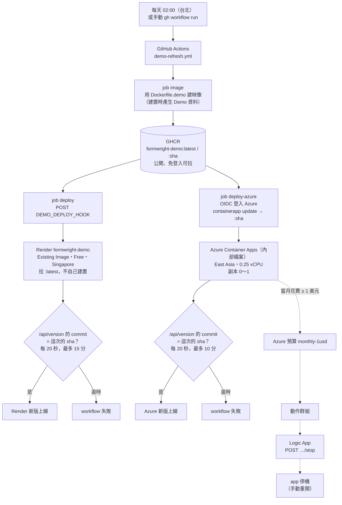

# 部署與環境變數

Formwright 的 Demo 站與容器部署做法。本機開發與測試見 [CONTRIBUTING.md](../CONTRIBUTING.md)；操作畫面見[操作手冊](manual.md)。

## Demo 部署（GHCR 映像＋託管平台拉映像）

`Dockerfile.demo` 把前端建置結果、後端與建置時產生的 Demo 資料打包成一個容器，API 與畫面在同一個網址。Render 免費方案每月的建置額度不夠用，所以改成由 GitHub Actions 建好映像推上 GHCR，託管平台只拉現成映像、不自己建置（使用者 2026-11-20 裁決）。目前 Render（公開 Demo）與 Azure Container Apps（內部備案）同步部署。

### 部署架構

原本由 Render 從 git 自己建置，推上 `main` 就自動部署。2026-11 本月 Render 建置額度用完，改成 GitHub Actions 每天建映像推上 GHCR，Render 與 Azure 備案拉同一份映像同步部署（使用者 2026-11-20 裁決）。推上 `main` 不再部署。



| | Render（公開 Demo） | Azure（內部備案） |
|---|---|---|
| 角色 | 公開 Demo | 內部備案 |
| 區域 | Singapore | East Asia |
| 休眠 | 閒置 15 分 | 閒置約 6.5 分縮到 0 |
| 喚醒 | 約 1 分鐘 | 約 27 秒 |
| 費用 | 免費 | 免費額度內，每月約 200 小時；超過 1 美元自動停機 |

1. 映像：`ghcr.io/kerryhuang/formwright-demo`，標籤有 `latest` 和 commit sha。託管平台要能拉得到：把 GHCR package 設成公開，或在平台設定 registry 認證。
2. 託管平台：建一個「從映像部署」的服務，映像填 `ghcr.io/kerryhuang/formwright-demo:latest`、健康檢查路徑 `/api/health/ready`，關掉 Auto-Deploy；把平台的 Deploy Hook 網址設成 GitHub secret `DEMO_DEPLOY_HOOK`。

目前的 Demo：<https://formwright-demo.onrender.com>，Render 與 Azure 同步部署（2026-11-20 run 44700316887 起）。

- **Render 服務 `formwright-demo`**：Existing Image 服務（拉 `ghcr.io/kerryhuang/formwright-demo:latest`），Free 方案、Singapore 區，健康檢查 `/api/health/ready`。環境變數三個：`Demo__LoginEnabled=true`、`Auth__TrustForwardedHeaders=true`、`Auth__ClientIpHeader=True-Client-IP`（登入限流讀 Cloudflare 填的來源 IP）。2026-11-20 本月建置額度已用完，拉映像部署仍成功；尚未在 Render 用量頁確認是否計入建置分鐘。
- **舊服務** `dynamic-modules-demo`（舊的 git 建置服務）：已在 Render 暫停（Suspend，使用者 2026-11-20 裁決），舊網址回 503；要恢復到該服務的 Settings 按 Resume。

限制：免費方案閒置 15 分鐘會休眠，下次開啟要等約 1 分鐘；沒有永久磁碟，休眠重啟後資料回到映像建置時的 Demo 資料（`Dockerfile.demo` 在建置時就產生好，喚醒後不用等），日期停在建置那天，每天的排程部署會更新。Demo 站開了一鍵登入（`Demo__LoginEnabled`），任何人點一下就能以任何 Demo 帳號含 `admin` 登入，所以站上只放虛構的示範資料，請勿輸入真實資料。Render 上 cookie 帶 `secure; samesite=lax; httponly`（2026-11-05 實測）。

啟動時自動產生 Demo 資料：設定環境變數 `Demo__SeedOnStartup=true`，站台會在背景產生訂單、設備報修、設備保養、品質異常四組模組與範例記錄；本機預設關閉，Demo 映像改在建置時產生，不需要這個設定。也可以由系統管理員在「系統管理 → Demo 資料」手動產生。各情境怎麼示範見 [Demo 腳本](demo.md)。

### Demo 每日部署

推上 `main` 不會部署。`.github/workflows/demo-refresh.yml` 每天台北時間 02:00（UTC 18:00）跑一次，不判斷當天有沒有改動，順便讓 Demo 資料的日期每天更新：

1. 用 `Dockerfile.demo` 建映像（build-arg `GIT_COMMIT` 是這次的 sha），推上 GHCR 的 `latest` 與 `<sha>`。
2. 呼叫 `DEMO_DEPLOY_HOOK`，接著每 20 秒讀一次 `<DEMO_URL>/api/version`，`commit` 等於這次的 sha 才算成功，最多等 15 分鐘，逾時讓排程失敗。部署期間舊實例會繼續服務，只看健康檢查分不出新舊版，所以比對 commit。

設定：

- secret `DEMO_DEPLOY_HOOK`：託管平台的 Deploy Hook 網址（GitHub repo → Settings → Secrets and variables → Actions → Secrets）。沒設定時只建映像、印警告、照樣成功結束；有設定時先去掉前後空白與換行，不是 `https://` 開頭就報錯讓排程失敗。舊 secret `RENDER_DEPLOY_HOOK` 已於 2026-11-20 刪除。
- variable `DEMO_URL`：Demo 站網址（同一頁的 Variables），沒設定時用 `https://formwright-demo.onrender.com`。

GitHub Deployments：Render 的部署寫入環境 `demo`（附 Demo 網址）；舊環境 `main - dynamic-modules-demo` 是舊服務的 Render 整合留下的歷史紀錄。Azure 備案刻意不寫入：它是不公開的內部備案，不放進公開的 Deployments（使用者 2026-11-20 裁決）。若日後要加，需先在 Azure 新增 subject 為 `repo:<owner>@<owner-id>/<repo>@<repo-id>:environment:demo-azure` 的聯合憑證，否則 OIDC 登入會失敗（現有憑證只認 `ref:refs/heads/main`）。

急著上線：`gh workflow run demo-refresh.yml`（或 GitHub → Actions → demo-refresh → Run workflow），不必等到隔天 02:00。

### Azure Container Apps 備案

同一個映像另外部署一份到 Azure Container Apps 當備案（使用者 2026-11-20 裁決），由 `demo-refresh.yml` 的 `deploy-azure` job 和 `deploy` 並列執行，每天跟著排程更新。

- 資源：資源群組 `formwright-demo-rg`、Container App `formwright-demo`，區域 `eastasia`，0.25 vCPU／0.5Gi，最少 0、最多 1 個副本，不接 Log Analytics。縮到 0 後第一個請求冷啟動約 27 秒。
- 費用：用 Container Apps 的每月免費額度，以這個規格約可運作 200 小時；閒置時縮到 0 不計費。
- 費用保護：預算 `monthly-1usd`（每月 1 美元）。實際花費達 80% 寄信、預估超過 100% 寄信；實際達 100% 時，預算觸發動作群組 `formwright-demo-stop`，由 Logic App `formwright-demo-stop` 以受控識別 POST Container App 的 `/stop` 停機（受控識別只授權到這個 app）。
  - 費用資料約延遲一天，可能小幅超過預算。
  - 停機後備案就沒了，要手動重開（az 2.90 沒有 `containerapp start` 子指令）：`az rest --method post --url "https://management.azure.com/subscriptions/<訂閱 ID>/resourceGroups/formwright-demo-rg/providers/Microsoft.App/containerApps/formwright-demo/start?api-version=2024-03-01"`。
  - 2026-11-20 實測：Logic App 觸發後 20 秒內停機，重開正常；預算到 100% 的整條鏈還沒真的觸發過。
- 身分：GitHub OIDC（不存 client secret），聯合憑證只允許本 repo 的 `main` 分支，角色只授予這個 Container App。聯合憑證的 subject 要用 GitHub 的新格式 `repo:<owner>@<owner-id>/<repo>@<repo-id>:ref:refs/heads/main`；用舊格式 `repo:<owner>/<repo>:ref:...` 會登入失敗（AADSTS700213）。
- job 步驟：`azure/login` 登入 → `az containerapp update` 把映像換成 `ghcr.io/kerryhuang/formwright-demo:<sha>` → 每 20 秒讀一次 `<DEMO_AZURE_URL>/api/version`，`commit` 等於這次的 sha 才算成功，最多 10 分鐘，逾時讓 job 失敗。

設定（GitHub repo → Settings → Secrets and variables → Actions）：

- secrets `AZURE_CLIENT_ID`、`AZURE_TENANT_ID`、`AZURE_SUBSCRIPTION_ID`：OIDC 身分的識別碼。`AZURE_CLIENT_ID` 沒設定時 job 印警告、略過部署、照樣成功結束。
- variable `DEMO_AZURE_URL`：備案站網址（不含結尾斜線）；網址不公開，只存在這個 variable。

## 環境變數

| 變數 | 用途 |
|---|---|
| `Auth__InitialAdminPassword` | 全新安裝時 `admin` 的初始密碼（至少 8 碼）；沒設就產生隨機密碼，印在啟動 log |
| `Auth__ResetAdminPassword` | 緊急救援：啟動時重設 `admin` |
| `Auth__ClientIpHeader` | 反向代理後面時，登入限流改讀這個標頭的來源 IP（須是代理自己填、不接受客戶端帶入的標頭，如 `True-Client-IP`）；沒設就用連線來源，所有人會共用一個額度 |
| `Auth__TrustForwardedHeaders` | 在反向代理後面時設 `true`，cookie 才會加 `Secure` |
| `Demo__LoginEnabled` | 登入頁列出 Demo 帳號一鍵登入 |
| `Demo__SeedOnStartup` | 啟動時背景產生 Demo 資料 |
| `Attachments__Root` | 附件存放目錄；沒設就放在資料庫旁的 `attachments`（記憶體資料庫放暫存目錄） |
| `Attachments__UploadEnabled` | 是否開放上傳；沒設時 `Demo__LoginEnabled` 為 `true` 就關閉，否則開放 |
| `Localization__PackImportEnabled` | 是否開放匯入語系包（套用、回到上一版、移除覆寫、移除語系）；沒設時 `Demo__LoginEnabled` 為 `true` 就關閉（只能預覽報告），否則開放 |
| `Attachments__DisabledReason` | 關閉上傳時顯示給使用者的原因 |
| `Attachments__MaxBytes`、`Attachments__MaxFilesPerField`、`Attachments__AllowedExtensions__0`… | 附件政策在這個環境的出廠值，見下方「附件設定與政策出廠值」 |
| `App__PublicUrl` | 站台對外網址（例如 `https://erp.example.com`），帳號信（驗證信）與告警信裡的連結、AI 連線的伺服器網址與來源檢查都用它；不用請求的 Host 標頭。要填完整網址（含 `https://`），格式不對的值會被忽略並在啟動 log 記警告（`App__PublicUrl` 填錯時改讀舊鍵）；正式環境用 `http://` 也會記警告，因為信裡的驗證連結會以明文傳輸。沒設時讀舊鍵 `Ops__PublicUrl`；兩個都沒設時告警信不放連結、帶連結的帳號信寄不出去（寄送紀錄標「沒有站台網址」）。Demo 站不必設（收件匣用站內相對網址） |
| `Mail__Delivery__Enabled` | 帳號信寄送服務，預設 `true`；設 `false` 時信留在寄送紀錄的「等待寄送」不寄出（多台部署可以只讓一台開著，同一封信靠資料表領取只寄一次） |
| `Ops__Edition` | 版別，`Cloud` 或 `OnPrem`（區分大小寫，其他值記 Warning 並當 `OnPrem`）；顯示在系統管理員的 ops info。⚠️ 雲端主機填錯（例如 `cloud`）會被當成地端版，備份狀態會把備份路徑顯示給客戶管理員 |
| `Backup__Root` | 產品內備份的位置（本機目錄）；沒設就不備份。見下方「產品內備份」 |
| `Backup__PgDumpPath` | 只在 `Postgres` 用：`pg_dump` 的路徑，`pg_restore` 要在同一個目錄；沒設就找 `PATH`。客戶用 `Dockerfile` 已裝好並設成 `/usr/lib/postgresql/16/bin/pg_dump` |
| `Ops__TrustIncomingTraceParent` | 預設 `false`：忽略外來的 `traceparent`，request id 由伺服器產生；放在自家反向代理後面、要串接上游 trace 時才設 `true` |
| `Ops__Scheduler__Enabled` | 背景排程器（通知維護等），預設 `true`；設 `false` 整個不跑。多實例時同一工作靠資料表租約只跑一份，也可以只讓其中一台開著；實例之間的時鐘誤差由 5 分鐘租約吸收，主機請開 NTP 校時 |
| `Sqlite__MmapSizeMb` | SQLite 每條連線的記憶體對映大小，單位 MB，預設 `0`（關閉）；也可寫在 `appsettings.json` 的 `Sqlite:MmapSizeMb` |
| `Database__Provider` | 資料庫種類：`Sqlite`（預設）或 `Postgres`，其他值拒絕啟動。`Postgres` 時 `ConnectionStrings__Dynamic` 是 Npgsql 連線字串，目標資料庫要先建好（不存在就拒絕啟動，系統不代建）。報表在兩種資料庫行為相同（能在資料庫端聚合就走 SQL 路徑） |
| `Database__LockTimeoutSeconds` | 只在 `Postgres` 生效：寫入排隊與全庫寫入鎖各自的等待上限（秒），預設 `30`，逾時回 503；`0` 是不設上限 |
| `DataProtection__KeysDirectory` | 加密金鑰的存放目錄（相對路徑以站台目錄解析）：登入 cookie、寄信設定的 SMTP 密碼、雙因素驗證的金鑰都靠它。沒設時，SQLite 檔案資料庫放在資料庫檔案旁的 `keys`；其他情況（PostgreSQL、記憶體資料庫、`file:` 開頭的連線字串）在 Development 以外的環境**拒絕啟動**。Development 環境允許不落地，但雙因素驗證不能啟用，並開「伺服器沒有保存加密金鑰」事件。金鑰目錄要和資料庫一起備份；換成空目錄啟動且資料庫裡已有雙因素或 SMTP 密碼的密文時，開「金鑰可能遺失」事件 |
| `Install__ConfigFile` | 安裝版設定檔的路徑（對應設定鍵 `Install:ConfigFile`）；有設就以這份 JSON 為最高優先的設定來源，優先於環境變數與命令列。沒設的部署（Demo、`docker run`、開發）行為不變 |
| `Install__InitIfMissing` | 只有 Docker compose 設：設定檔不存在時容器啟動自動建立並產生設定碼 |
| `Install__DataDirectory`、`Install__BackupDirectory` | 安裝版的資料與備份位置，精靈的環境檢查用它檢查可寫與是否重疊 |
| `Install__BackupBeforeUpgrade` | 只有 Docker compose 設（`true`）：換映像後第一次啟動先備份再升級，失敗進維護模式。Windows 與 Ubuntu 由安裝程式在升級前備份，不用這個鍵 |
| `Setup__Pending` | 設定模式旗標：精靈完成前為 `true`，站台只開精靈；由安裝程式寫入設定檔，精靈完成後自動移除 |
| `Server__Port` | 站台聽的連接埠，安裝版預設 8080 |

`Auth__InitialAdminPassword` 只在資料庫還沒有可用的管理員時有效，之後改它不會覆寫既有密碼。`Auth__ResetAdminPassword` 至少 8 碼，會重設 `admin` 的密碼、啟用、解鎖、要求改密碼並讓所有 session 失效；它也會清掉 `admin` 的雙因素驗證（金鑰、復原碼），救回後要把它移除，否則每次重啟都會再重設，維運監控也會一直開「緊急救援設定還沒移除」事件。`Demo__LoginEnabled` 絕不能在正式站開啟，它不驗密碼。Swagger 只在 Development 環境開放。

`Sqlite__MmapSizeMb` 是大型部署的效能設定，用在資料庫檔案達數 GB、查詢以索引篩選為主的站台：負載測試中索引型查詢單人快 30% 至 45%（[儲存層負載報告](superpowers/specs/2026-11-06-storage-load-report.md) §5）。對映大小要接近資料庫檔案的大小才有效果（只開 256 MB 對 3 GB 的資料庫看不出差別），數值大於檔案時只會用到檔案那麼多；代價是占用位址空間，頁面快取由作業系統管理，實體記憶體不足的主機請維持關閉。設定逐連線生效，改值後要重啟站台；0、負數與非數字都視為關閉。只有 SQLite 會套用。

## 附件設定與政策出廠值

`Attachments` 節（環境變數寫成 `Attachments__名稱`，也可寫在 `appsettings.json`）分兩類：

- **部署設定**：`Root`、`UploadEnabled`、`DisabledReason`，只能在這裡設定。
- **政策出廠值**：`MaxBytes`（單檔大小，位元組）、`MaxFilesPerField`（每個附件欄位的檔案數）、`AllowedExtensions`（副檔名白名單，陣列；環境變數用 `Attachments__AllowedExtensions__0`、`__1`…）。有寫才算，沒寫用程式出廠值。這幾個值是該環境的**出廠值**，系統管理員可以在「系統管理 → 政策設定」覆蓋它（單檔大小、檔案數也可以再由模組覆寫）；畫面上按「恢復出廠值」回到這裡的值。改設定檔要重啟站台才會生效。

政策有技術上下限（單檔 1 到 52428800 位元組、每欄位 1 到 100 個檔案、白名單最多 40 個）。設定檔的值超出範圍時，啟動會記一則 Warning 並夾到上下限（例如 `MaxBytes=999999999` 會變成 52428800）；非數字的值記 Warning 並改用程式出廠值。白名單裡的網頁、腳本與可執行檔副檔名（html、svg、js、exe 等，完整清單見[操作手冊](manual.md#系統管理政策設定)）不論誰設都不收：設定檔裡的這類項目會被丟掉並記 Warning。

## log、健康檢查與版本

- **log**：非開發環境輸出 JSON 到 stdout（`appsettings.json` 的 `Logging:Console`），由 Docker、systemd 或 Windows 服務包裝程式收集；開發環境維持純文字。4xx、5xx 與超過慢請求門檻的請求結束時記一行（只用路由樣板，不記查詢字串）；一般成功的請求是 Debug，預設不輸出，要看時設 `Logging__LogLevel__DynamicModules.WebAPI.Ops=Debug`，同一個請求的所有 log 都帶 `requestId` 欄位，回應標頭 `X-Request-Id` 與錯誤回應主體的 `traceId` 是同一個值。框架自帶的 `RequestId` 欄位（連線序號格式）是另一個東西，查同一請求請用 `requestId`。慢請求門檻在「系統管理 → 政策設定」。
- ⚠️ **產品 log 可能含例外原文**：框架的例外訊息可能帶輸入值，前端錯誤回報也會把原始訊息與 stack 記進 log，所以 log 視同敏感資料控管存取。
- **健康檢查**：`/api/health/live`（程序活著）、`/api/health/ready`（資料庫可連線，逾時 2 秒回 503）、`/api/health`（同 live，相容舊設定）。Render 與 Azure 的健康檢查都設 `/api/health/ready`。
- **版本**：`GET /api/version` 回 `version`、`commit`、`builtAt`。Docker build-arg `APP_VERSION`、`GIT_COMMIT`（沒給時退回 Render 的 `RENDER_GIT_COMMIT`）、`BUILD_TIME`（沒給時用建置當下）注入；沒注入的欄位顯示 `dev`。原始碼沒變時 Docker 沿用快取層，`builtAt` 可能停在舊時間。
- **自訂指標**：目前沒有匯出端；要看用 `dotnet-counters monitor --counters Formwright`（執行次數、前端錯誤收件數、規則失敗數）。

## 單一 instance 與 volume

登入失敗計數用程序內的鎖保護，假設每家客戶只跑一個後端 instance。Docker 部署要把資料庫目錄（`/app/data`）掛成 volume，登入金鑰才會保留。

⚠️ 已知限制：資料庫持續讀不到時，政策設定（含營運時區與語系）沿用上次成功讀到的值、沒有時間上限；站台啟動時就讀不到資料庫則先用出廠值，恢復後最多 10 秒重新讀取。

⚠️ 多台部署：全系統政策（含維運政策與營運時區）每台各自快取，在別台改的值最多 60 秒後才在這台生效（與 O1 的維運政策快取是同一份）。改營運時區的那一刻，其他台在這段時間內用舊時區寫入的日期時間索引會永久差一段時差，所以**改時區請在離峰時段、先縮成一台再改**，改完再擴回多台。

## 產品內備份

設了 `Backup__Root` 就每天自動備份一份（政策「每天幾點自動備份」，營運時區，出廠 02:00），系統管理員也可以按「立即備份」。一份備份含資料庫快照與附件，不含登入金鑰（設計見[備份設計](superpowers/specs/2026-11-21-backup-design.md)）。SQLite 的快照是 `database.sqlite`，PostgreSQL 是 `pg_dump` 產生的 `database.pgdump`（custom 格式）。

- **放另一顆磁碟或另一個 volume**：備份位置不能和資料庫目錄、附件根目錄、金鑰目錄、站台的 `wwwroot` 相同或互相包含（不分大小寫），否則啟動記 Warning、不備份、「備份」檢查判嚴重。Docker 部署要另掛一個 volume，例如 `-v formwright-backup:/backup -e Backup__Root=/backup`。
- **多台部署**：每台的 `Backup__Root` 要指到同一個共享掛載（同一份備份只會有一台在做），或只讓其中一台開背景工作（`Ops__Scheduler__Enabled=true`），其他台設 `false`。背景工作關閉的那台不做備份。
- **位置標記檔**：第一次備份時在位置根目錄寫 `.formwright-backup-location`。之後位置裡的標記檔和資料庫記的不同（換了掛載、或兩台指到不同地方）就停下來不備份、判嚴重。要換到新位置：直接改 `Backup__Root`，新位置沒有標記檔，會當成新位置重新做第一份；**要換回以前用過的位置，先刪掉那裡的標記檔**。
- **保留**：排程備份留最新 7 份、立即備份留 7 天（政策設定可改），最新一份成功的永遠不刪；清掉的備份記在稽核（`backup.prune`）。位置空間不夠時備份失敗、不寫任何檔。
- 備份目錄權限：目錄 0700、檔案 0600（作業系統不支援時記一次 Warning）。
- **部署與重啟**：重啟會中斷執行中的備份，記成「中斷」並在下一輪自動重試（同一時段最多 3 次）。部署前先確認沒有執行中的備份（`GET /api/v3/dynamic/system/ops/backups` 的 `current`；監控頁的「備份」分頁隨 bk1c 上線）。
- **PostgreSQL 的 `pg_dump`**：
  - 站台主機（或容器）要有 PostgreSQL 用戶端，主版本不小於資料庫伺服器（新版用戶端能備舊版伺服器）。找不到是 `pgDumpMissing`，版本太舊是 `pgDumpVersion`，訊息帶兩個版本。
  - 連線沿用 `ConnectionStrings__Dynamic`：主機、埠、資料庫、帳號以環境變數交給 `pg_dump`，密碼寫進只有站台帳號讀得到的暫存檔、用完即刪，不出現在命令列或 log。
  - 帳號與密碼要寫在 `ConnectionStrings__Dynamic` 裡（或用連線字串的 `Passfile`）。只靠 `PGUSER`、`PGPASSWORD` 這類環境變數給的部署，站台連得上，但 `pg_dump` 拿不到（子程序只帶必要的環境變數），備份會認證失敗。
  - 用 `Passfile` 時，檔案權限要是 0600：`pg_dump`（libpq）會拒絕群組或其他人讀得到的檔，站台本身（Npgsql）不檢查，所以會出現站台正常、備份認證失敗的情況。
  - `pg_dump` 子程序只帶白名單裡的環境變數，含密碼的變數（`PGPASSWORD`、連線字串）兩邊都不帶：
    - Linux、macOS：`PATH`、`HOME`、語系（`LANG`、`LC_*`）、`TZ`、`TMPDIR`、OpenSSL 憑證（`SSL_CERT_FILE`、`SSL_CERT_DIR`、`OPENSSL_CONF`）、Kerberos（`KRB5CCNAME`、`KRB5_CONFIG`）、動態連結器的搜尋路徑（`LD_LIBRARY_PATH`、`DYLD_LIBRARY_PATH`，PostgreSQL 用戶端裝在非標準位置、要靠它找到 libpq 時用得到）。
    - Windows（名稱不分大小寫）：`PATH`、`PATHEXT`、`SystemRoot`、`windir`、`SystemDrive`、`TEMP`、`TMP`、`USERPROFILE`、`APPDATA`、`LOCALAPPDATA`、`COMSPEC`、OpenSSL 憑證（`SSL_CERT_FILE`、`SSL_CERT_DIR`、`OPENSSL_CONF`）、Kerberos（`KRB5CCNAME`、`KRB5_CONFIG`）。不帶 `LD_*`、`DYLD_*`、`LC_*`、`HOME`。
  - 備份歷程的錯誤摘要會遮掉資料庫主機、IP、帳號、資料庫名、`pg_dump` 路徑（設定的或從 `PATH` 找到的）、站台的工作目錄、家目錄（`HOME`、`USERPROFILE`、`APPDATA`、`LOCALAPPDATA`，換成 `<家目錄>`）、暫存目錄（換成 `<暫存目錄>`），以及連線字串的 `Root Certificate`、`SSL Certificate`、`SSL Key`、`Passfile` 路徑；完整訊息記在站台 log 的 Warning「備份失敗」。遮罩本身出錯時，摘要只寫一句固定文字，這份照樣記成失敗。
  - SSL：`SSL Mode` 照同名對應；`Trust Server Certificate=true` 只能配 `SSL Mode=Require`（不驗憑證）；`VerifyCA` 要設 `Root Certificate`；不支援 `SSL Password`。對不上時是 `pgDumpConfig`，訊息寫出是哪個設定。
- **PostgreSQL 部署前**：先確認沒有執行中的備份（同上）。`pg_dump` 不擋一般寫入，但會擋住新版啟動時的 migration（DDL 要等它的鎖）：排程備份避開備份時段部署即可；立即備份任何時刻都可能在跑，有的話等它結束再部署，否則新版會卡在啟動。站台關閉或備份逾時時，產品會結束整個 `pg_dump` 程序。

### 從備份還原（SQLite）

安裝版（Windows、Ubuntu、Docker compose）的指令與路徑見[安裝版的還原](#安裝版的還原)。

1. 停站台。
2. 在 `<Backup__Root>/sets/` 選一份，確認它不比要啟動的版本新：舊備份可以用新版啟動（migration 會往前升），新備份不能用舊版開。
   - 比對 `manifest.json` 的 `appVersion`。
   - 版本是 `dev`（本機與 Demo）時改比 `migrationId`：備份的 `migrationId` 必須在要啟動的版本的 migration 清單裡。
3. 把那份的 `database.sqlite` 複製成資料庫檔（例如 `/app/data/poc.db`），刪掉舊的 `-wal`、`-shm`。
4. 把 `<Backup__Root>/attachments/` 整個複製到附件根目錄。多出來的檔案是別份備份的，之後可以用「清孤兒附件」清掉。
5. 啟動。
   - 原本的金鑰目錄還在（同一台主機、只是資料庫壞了）：保留金鑰目錄，不必重新登入、也不必重填密碼。
   - 金鑰目錄也沒了（換主機、整顆磁碟壞）：所有人要重新登入，系統管理員要到「寄信設定」重填密碼。

### 從備份還原（PostgreSQL）

還原到一個**新的空資料庫**，確認沒問題再把站台切過去；原本的資料庫留到確認完再刪。用的 PostgreSQL 用戶端主版本不小於備份時的伺服器。

1. 停站台（多台部署時全部停）。
2. 選一份 `sets/<名稱>/`，確認它不比要啟動的版本新（同 SQLite 第 2 步）；`manifest.json` 的 `provider` 要是 `postgres`。
3. 用站台的資料庫帳號建一個空資料庫，再還原進去：

   ```bash
   createdb -h <主機> -U <站台帳號> -T template0 <新資料庫>
   pg_restore -h <主機> -U <站台帳號> --no-owner --no-privileges --exit-on-error --dbname=<新資料庫> <Backup__Root>/sets/<名稱>/database.pgdump
   ```

   - 帳號沒有建庫權限時，請資料庫管理員建好 `<新資料庫>` 並把擁有者設成站台帳號。
   - 確認：`psql -h <主機> -U <站台帳號> -d <新資料庫> -c 'SELECT max("MigrationId") FROM "__EFMigrationsHistory"'` 的結果等於 `manifest.json` 的 `migrationId`。
4. 把 `<Backup__Root>/attachments/` 整個複製到附件根目錄（同 SQLite 第 4 步）。
5. 把 `ConnectionStrings__Dynamic` 的 `Database` 改成 `<新資料庫>`，啟動。金鑰目錄的處理同 SQLite 第 5 步。

## 安裝版（Windows、Ubuntu、Docker compose）

給 50 人以下、放在公司內網的站台：三種安裝方式共用同一套瀏覽器設定精靈（環境檢查、資料庫、管理員密碼、公司名稱、備份位置），畫面步驟見[操作手冊](manual.md#安裝版的設定精靈)。只管內網；要從外網連進來請自行用 VPN 或 Cloudflare Tunnel，或改用雲端版，安裝版不處理。第一版不簽章。

安裝檔都在專案的 [Releases 頁](https://github.com/KerryHuang/formwright/releases)。

### 三條安裝路

第一次安裝、不熟電腦請看 [Windows 安裝教學](install-windows.md)或 [Ubuntu 安裝教學](install-ubuntu.md)（含截圖）。

| | 指令或操作 |
|---|---|
| Windows 10／Server 2019 以上（x64） | 下載 `Formwright-Setup-<版號>.exe`，按右鍵「以系統管理員身分執行」。最後一頁顯示網址與設定碼 |
| Ubuntu 22.04／24.04（x86_64） | `curl -fsSL https://github.com/KerryHuang/formwright/releases/latest/download/install.sh \| sudo bash`；終端輸出網址與設定碼 |
| Docker compose | 下載 Releases 的 `docker-compose.yml`，`docker compose up -d`；設定碼用 `docker compose logs formwright` 找 |

- **預發版**（tag 有後綴，例 `v0.1.0-rc.1`）：Release 標成 prerelease，`releases/latest` 不會指向它；Ubuntu 改用 `curl -fsSL https://github.com/KerryHuang/formwright/releases/download/<tag>/install.sh | sudo bash`，Windows 與 Docker 到該版的 Release 頁下載。映像只推版號 tag，不更新 `latest`。
- **SmartScreen**：Windows 安裝檔沒有簽章，執行時會出現「Windows 已保護您的電腦」。按「其他資訊」→「仍要執行」。
- **設定碼**：精靈第一步要輸入的 12 碼英數字（例 `K7QM-3HZP-W2XA`），只能用一次。Windows 在安裝程式最後一頁；Ubuntu 在安裝指令的輸出（`FORMWRIGHT_SETUP_CODE=` 那一行）；Docker 在容器 log。**沒抄到或忘了**：設定碼存在資料目錄的 `setup-code` 檔，重啟不會重生，精靈完成才刪除，所以精靈完成前都能讀回來：Windows 用「以系統管理員身分執行」的記事本開 `C:\ProgramData\Formwright\data\setup-code`；Ubuntu 執行 `sudo cat /var/lib/formwright/data/setup-code`（資料目錄只有 root 與 `formwright` 帳號讀得到）；Docker 執行 `docker compose logs formwright` 找「設定精靈的設定碼」那行（檔案在 data volume 的 `/app/data/setup-code`）。安裝程式只在全新安裝時顯示設定碼，升級與重新安裝不會再顯示。
- **雙因素**：依系統預設，管理員第一次登入後會先被要求設定雙因素驗證，要準備好驗證器 App。
- **語言**：安裝程式與腳本提供繁體中文與英文。Windows 只有繁中介面的 Windows（含香港、澳門）用繁中，其他一律英文；Ubuntu 只有系統語言是 `zh_TW`、`zh_HK`、`zh_MO` 才用繁中，其他一律英文。`sudo` 會丟掉呼叫端的環境變數，所以要指定語言請寫成 `curl … \| sudo bash -s -- --lang zh-TW`（或 `--lang en`）。
- **Ubuntu 的選項**：`--port <n>`（只在全新安裝生效）、`--skip-backup`、`--lang <zh-TW|en>`；動作 `remove`、`purge`（`curl … \| sudo bash -s -- remove`）。Windows 靜默安裝參數：`/PORT=<n>`、`/SKIPBACKUP`、`/FIREWALLSCOPE=<範圍>`；解除安裝帶 `/DELETEDATA`。
- **Windows 防火牆**：安裝程式建一條輸入規則「Formwright」，只放行 Formwright 程式、該連接埠，來源預設只有同網段（`localsubnet`），所有網路設定檔都適用。其他網段的電腦要連，安裝時帶 `/FIREWALLSCOPE=<netsh remoteip 值>`（例 `192.0.2.0/24,198.51.100.0/24`）；之後升級或重裝不帶參數會沿用上次的範圍。每次安裝都會刪掉舊的同名規則再重建。
- **Windows 安裝失敗時**：權限、初始化、防火牆或服務 60 秒內沒有正常回應任一步失敗，安裝程式以結束碼 20 結束，Formwright 服務會停止並設成「停用」，避免一直自動重啟；排除問題後重新執行安裝程式即可（會改回自動並啟動）。若訊息說服務沒能停用，請手動執行 `sc config Formwright start= disabled` 與 `sc stop Formwright`。
- **資料目錄權限（Windows）**：全新安裝時安裝程式建立資料目錄（`C:\ProgramData\Formwright`）並設定權限，只留 SYSTEM、Administrators 與服務帳號。升級（目錄已存在）只檢查、不重設：安裝程式不改寫任何既有檔案與目錄的權限或擁有者。整棵樹先唯讀檢查，有連結（junction、符號連結）、擁有者不是 SYSTEM／Administrators／TrustedInstaller／Formwright 服務帳號、SYSTEM／Administrators／Formwright 服務帳號以外有人有寫入類權限，或檔案有多個硬連結，再比對是否恰為預期的權限：父目錄是受保護（不繼承）、擁有者 Administrators、三條明確 ACE（SYSTEM、Administrators 完全控制，服務帳號剛好是「修改」，多一個權限位元也不行）；其下每個子項由父目錄繼承同樣三條 ACE，沒有任何其他授權。**本機系統管理員帳號的授權不擋升級**（使用者裁決 2026-11-27）：目前是本機 Administrators 群組直接成員的使用者帳號，名下額外的 Allow 授權（任意權限、明確或繼承）視為可信，例如用檔案總管開資料夾、按「繼續」時 Windows 自動替該帳號加的完全控制；這類授權不會被改寫，安裝 log 會各留一行說明（SID 與第一個路徑）。群組的巢狀成員不展開，Deny 授權、非管理員帳號（含 Users 與一般本機使用者）的授權（含唯讀）、擁有者規則都照舊；列不出本機 Administrators 的成員時一律拒絕。其他有偏差——包括自己替非管理員帳號加的讀取授權——就拒絕安裝，以結束碼 20 結束（服務維持停用，原因、路徑與違反的規則寫在安裝 log）。拒絕時既有項目的權限與擁有者沒有被改寫，但升級前備份、程式檔替換與補建缺少的 `data`、`backup` 子目錄（只繼承父目錄的權限）可能已經完成。請依 log 寫的路徑手動移除該授權或修好（例如移除授權後對該項目執行 `icacls <路徑> /reset`），再重新執行安裝程式（會重新啟用服務）。資料目錄的上一層 `C:\ProgramData` 若有非系統帳號能刪除或改名它，全新安裝與升級都會拒絕。請勿另外把資料目錄的寫入權授給其他帳號：既有項目不會被改權限，但安裝程式無法排除該帳號持有舊檔案控制代碼、在目錄內植入連結，此後安裝與服務在目錄內做的事不在這項檢查的保護範圍。

### 預設位置

來源是 [`installer/install-defaults.json`](../installer/install-defaults.json)，安裝程式、腳本與 compose 檔的預設值都由它產生；要改預設值改那一份，不要手改產生的檔案。

| | Windows | Ubuntu | Docker compose |
|---|---|---|---|
| 程式 | `C:\Program Files\Formwright` | `/opt/formwright` | 映像內 `/app` |
| 資料（資料庫、附件、金鑰） | `C:\ProgramData\Formwright\data` | `/var/lib/formwright/data` | volume `formwright-data` → `/app/data` |
| 備份 | `C:\ProgramData\Formwright\backup` | `/var/lib/formwright/backup` | volume `formwright-backup` → `/backup` |
| 設定檔 | `C:\ProgramData\Formwright\formwright.json` | `/etc/formwright/formwright.json` | `/app/data/formwright.json`（在 `formwright-data` volume 裡） |
| 連接埠 | 8080 | 8080 | 主機 8080（改 `FORMWRIGHT_PORT`） |
| 服務 | 服務 `Formwright`，帳號 `NT SERVICE\Formwright`，開機自動啟動 | systemd `formwright`，帳號 `formwright` | `restart: unless-stopped` |
| 擁有者與權限 | 資料目錄不給 `BUILTIN\Users` | `/etc/formwright`：root:formwright 0770；`/var/lib/formwright`：root 0755；其下 `data`、`backup`：formwright 0700 | volume 由容器管理 |

### 改連接埠

改設定檔的 `Server:Port`，再讓服務用新埠重啟。

- **Windows**：改完重啟服務；另要改防火牆規則「Formwright」的連接埠（安裝時只替安裝當下選的埠開規則）。
- **Ubuntu**：改完設定檔後，**重跑同一行安裝指令**。腳本偵測到已安裝會走升級流程：先停服務、備份、換程式，並依設定檔裡的新埠重寫服務單元（埠低於主機「非特權埠起點」時自動加 `CAP_NET_BIND_SERVICE`），再啟動；重跑也會升級到 Releases 目前最新版。只重啟（`systemctl restart formwright`）**不會**重寫服務單元，改成低埠會綁不上。不想重跑腳本時，改用 systemd override：`sudo systemctl edit formwright`，加入 `[Service]` 與 `AmbientCapabilities=CAP_NET_BIND_SERVICE`，存檔後 `sudo systemctl daemon-reload && sudo systemctl restart formwright`。只有 `/proc/sys/net/ipv4/ip_unprivileged_port_start`（Ubuntu 預設 1024）大於新埠時才需要這個設定。升級流程不會替新埠開 ufw，要自己執行 `sudo ufw allow <新埠>/tcp`（ufw 有啟用時）。
- **Docker compose**：改主機這一側：`FORMWRIGHT_PORT=9090 docker compose up -d`。

設定檔優先於環境變數：安裝版的所有設定都以設定檔為準，精靈完成後改的也是這份；Docker compose 要改設定請改 `formwright-data` volume 裡的 `formwright.json`，不是改環境變數。

### 升級

- **Windows**：直接執行新版安裝程式。會先停服務、用舊版程式做一次備份，備份成功才換檔案；備份失敗就中止，安裝程式會把舊版服務重新啟動並等它回應；舊版沒能重新啟動時訊息會明說，要手動啟動服務。備份位置沒設時會問要不要略過備份（靜默安裝要帶 `/SKIPBACKUP`，否則中止）。資料與設定不動。
- **Ubuntu**：重跑同一行安裝指令。流程同上，備份失敗以結束碼 20 中止、舊版照跑；備份位置沒設或設定無效、又沒加 `--skip-backup` 時以結束碼 21 中止。`--skip-backup` 只略過「備份位置沒設或設定無效」，不略過備份失敗。升級前備份的完整輸出不印在終端，寫進 `/var/lib/formwright/logs/upgrade-<UTC 時間>-<程序編號>.log`（目錄 root 0700、檔案 0600；每次升級一個，不自動清除），終端只印一行結果；備份中止時印出 `FORMWRIGHT_BACKUP_…` 標記行、紀錄檔路徑與查看指令，不印原始內容。升級會先把 `/var/lib/formwright` 收緊成 root 0755。停服務之前會建立紀錄檔並寫入第一行；這時就建不出來或寫不進去（例如 `logs` 是符號連結、磁碟已滿）就中止，舊版照跑。開始之後才滿的情況檢查不到，會照備份程序的結束碼處理。
- **Docker compose**：Releases 附的 `docker-compose.yml` 固定在該版的映像版號，`docker compose pull` 只會重拉同一版，不會升級。升級用下列任一種方式：
  - 下載新版 Release 的 `docker-compose.yml` 覆蓋舊檔，再 `docker compose pull && docker compose up -d`。
  - 或不動檔案，pull 與 up 都帶同一個映像設定：`FORMWRIGHT_IMAGE=ghcr.io/kerryhuang/formwright:<新版號> docker compose pull && FORMWRIGHT_IMAGE=ghcr.io/kerryhuang/formwright:<新版號> docker compose up -d`（也可寫進 shell 環境，兩個指令才一致）。
  - repo 裡的 `deploy/docker-compose.yml` 範本才指向 `latest`。

  換映像後第一次啟動會自動先備份、再升級資料庫；備份做完前站台連不上，用 `docker compose logs -f formwright` 看進度。備份失敗，或備份位置沒設，站台只顯示「系統維護中」頁、資料庫不動。處理方式有兩條：換回舊版映像再 `up -d`，或修好備份 volume（可寫、空間夠）後重啟容器。

映像位址 `ghcr.io/kerryhuang/formwright`，標籤是版號與 `latest`（`latest` 在該版 Release 建好後才指到新版）。第一次發版後，套件預設是私有，要在 GitHub 套件設定頁改成 Public 才能免登入拉取。

### 安裝版的還原

用[產品內備份](#產品內備份)的一份 `sets/<名稱>/` 把資料庫與附件放回安裝版的資料目錄。通用原則同[從備份還原（SQLite）](#從備份還原sqlite)；這裡只列各平台的路徑與指令。先確認備份的 `manifest.json` 的 `appVersion` 不比已安裝的版本新（新備份不能用舊版開）。升級前備份在歷程裡顯示為「立即」、沒有操作者，`snapshotUtc` 在升級那一刻之前、`appVersion` 是升級前的版本。

下面三個平台的順序大致相同：停服務 → 另存現有資料 → 比對備份的 SHA-256 → 讀備份 manifest 的附件數、補附件（Ubuntu、Docker 放在覆蓋之前；Windows 在覆蓋之後）→ 覆蓋資料庫 → 啟動。**比對、另存、附件階段失敗時資料庫還沒被覆蓋**，停在那裡、不要啟動服務；**覆蓋資料庫開始之後才失敗**（複製、刪 WAL／SHM、啟動），要假設資料庫已經不是原樣：維持停站，不要啟動，從另存的副本取回（各平台的取回方式見下面每段結尾）。

**Windows**（已在真機演練，Windows 11、Formwright 0.1.0-rc.1；第 3 步的明確比對寫法是演練之後改的，沒有再單獨演練）：

1. 以系統管理員開 PowerShell，執行 `Stop-Service Formwright`，確認 `(Get-Service Formwright).Status` 是 `Stopped`。
2. 先把現有資料另存，還原有問題時可以放回去：把 `C:\ProgramData\Formwright\data\formwright.db*`（含 `-wal`、`-shm`）複製到別處（不要放進 `C:\ProgramData\Formwright`）。
3. 在 `C:\ProgramData\Formwright\backup\sets\` 選一份，看 `manifest.json` 的 `appVersion` 不比已安裝版本新，再比對雜湊，不符就停（`<名稱>` 換成那份的目錄名）：

   ```powershell
   $set = 'C:\ProgramData\Formwright\backup\sets\<名稱>'
   $want = (Get-Content -Raw "$set\manifest.json" | ConvertFrom-Json).database.sha256
   $got = (Get-FileHash "$set\database.sqlite" -Algorithm SHA256).Hash
   if ($want -notmatch '^[0-9a-fA-F]{64}$' -or $got -ne $want) { throw "SHA-256 不符或 manifest 讀不到，不要還原這一份" }
   ```

4. `Copy-Item "$set\database.sqlite" C:\ProgramData\Formwright\data\formwright.db -Force`，再刪掉 `formwright.db-wal`、`formwright.db-shm`。這樣是**覆蓋既有檔**，保留原檔的權限；不要用會保留來源權限的工具（`robocopy /SEC`、`xcopy /O`），否則資料目錄的權限會和預期不同，下次升級被拒絕。
5. 附件：先看所選備份的 `manifest.json` 裡 `attachments.count`（附件數）：是 0 就沒有附件要補，略過這一步；大於 0 就把 `C:\ProgramData\Formwright\backup\attachments\` 的內容複製到 `C:\ProgramData\Formwright\data\attachments\`（多出來的檔案可用「清孤兒附件」清掉）。大於 0 卻找不到 `backup\attachments` 資料夾，表示搬備份時漏帶了共用附件池，請先把同一備份根目錄的 `attachments\` 找回來；**不要用資料夾有沒有來判斷有沒有附件**。manifest 讀不到 `attachments.count` 時同樣先停下來。這一步在覆蓋資料庫之後，所以附件補不齊、決定放棄還原時，請用步驟 2 另存的副本把資料庫放回去。
6. `Start-Service Formwright`，用瀏覽器或 `Invoke-RestMethod http://127.0.0.1:<埠>/api/version` 確認有回應（埠見 `C:\ProgramData\Formwright\formwright.json` 的 `Server:Port`，預設 8080）。
7. **不要用檔案總管進 `C:\ProgramData\Formwright` 按「繼續」**：Windows 會替你的帳號加一條明確授權。管理員帳號的授權不擋升級（見上面「資料目錄權限」），但其他帳號的授權會。

**Ubuntu**（2026-11-27 在 WSL2 Ubuntu 24.04 以 root 照下面這段實跑：備份沒有附件時略過附件、還原後資料與備份一致、服務正常啟動。一般 sudo 帳號與備份裡有附件的真機情況未演練；有附件、缺附件池、雜湊不符、manifest 缺附件數這幾種另在 Ubuntu 24.04 容器內用假的 `systemctl` 驗過，不含真服務）：服務名 `formwright`，資料 `/var/lib/formwright/data`，備份 `/var/lib/formwright/backup`，資料庫檔 `formwright.db`；資料目錄與備份目錄擁有者是 `formwright:formwright`、0700，一般登入帳號進不去，所以檔案的列舉與複製都放在同一個 root shell 裡做。升級流程只對 `/var/lib/formwright`、`/etc/formwright`、`data`、`backup` 這幾個目錄重設擁有者與權限，**不檢查也不重設其下檔案**，所以還原後檔案的擁有者要維持 `formwright`，否則服務寫不進去。把 `<名稱>` 換成要還原的那份：

```bash
sudo systemctl stop formwright
sudo sh -c 'set -e
  # 服務必須確實停了：停止時 is-active 回非 0 是正常的，所以只比對輸出
  test "$(systemctl is-active formwright || true)" = inactive
  SET=/var/lib/formwright/backup/sets/<名稱>
  BACKUP=/var/lib/formwright/backup
  DATA=/var/lib/formwright/data
  # 另存現有資料（絕對路徑，只有 root 讀得到）；任何一步失敗就停，後面不會覆蓋
  SAVE=/root/formwright-pre-restore-$(date +%Y%m%d%H%M%S)
  mkdir -p "$SAVE" && chmod 700 "$SAVE"
  echo "原資料另存在 $SAVE"
  for f in "$DATA"/formwright.db*; do if [ -e "$f" ]; then cp -p "$f" "$SAVE"/; fi; done
  test -s "$SAVE/formwright.db"
  # 比對 manifest 的 database.sha256，不符就停
  want=$(sed -n "s/.*\"sha256\" *: *\"\([0-9a-fA-F]\{64\}\)\".*/\1/p" "$SET/manifest.json" | head -n 1 | tr A-F a-f)
  test -n "$want"
  got=$(sha256sum "$SET/database.sqlite" | cut -d" " -f1)
  test "$got" = "$want"
  # 附件數以 manifest 的 attachments.count 為準，不看附件池資料夾在不在；讀不到就停，不當成 0
  count=$(sed -n "/\"attachments\" *:/,/}/p" "$SET/manifest.json" | sed -n "s/.*\"count\" *: *\([0-9][0-9]*\).*/\1/p" | head -n 1)
  if [ -z "$count" ]; then echo "manifest 讀不到附件數（attachments.count），中止；資料庫沒有被動到" >&2; exit 1; fi
  if [ "$count" -eq 0 ]; then
    echo "這份備份沒有附件，略過"
  elif [ -d "$BACKUP/attachments" ]; then
    mkdir -p "$DATA/attachments"
    cp -r "$BACKUP/attachments/." "$DATA/attachments/"
    chown -R formwright:formwright "$DATA/attachments"
  else
    echo "這份備份有 $count 個附件，但找不到 $BACKUP/attachments/；請把同一備份根目錄的 attachments/ 一起找回再重跑，中止，資料庫沒有被動到" >&2
    exit 1
  fi
  # 從這裡開始資料庫會被覆蓋
  install -o formwright -g formwright -m 600 "$SET/database.sqlite" "$DATA/formwright.db"
  rm -f "$DATA/formwright.db-wal" "$DATA/formwright.db-shm"
  echo "還原完成；原資料另存在 $SAVE"
'
```

上面那段印出「還原完成」才執行 `sudo systemctl start formwright`，再 `curl -fsS http://127.0.0.1:<埠>/api/version` 確認（埠見 `/etc/formwright/formwright.json`）。沒印就不要啟動。排查：

- 在「從這裡開始資料庫會被覆蓋」之前停下來（訊息寫「資料庫沒有被動到」，或 SHA、另存失敗）：資料庫沒動，修好原因（例如把漏掉的 `attachments/` 找回）後重跑同一段。
- 覆蓋之後才失敗（`install` 或 `rm` 出錯、磁碟滿），或「還原完成」之後服務啟動失敗：**不要假設原資料庫沒變**，維持停站。另存副本在 `/root/formwright-pre-restore-<時間>/`，用 `sudo ls /root/` 找最新的那個目錄（腳本開頭也印過完整路徑）。取回原資料：`sudo sh -c 'cp -p /root/formwright-pre-restore-<時間>/formwright.db* /var/lib/formwright/data/ && chown formwright:formwright /var/lib/formwright/data/formwright.db*'`（原本若有 `-wal`、`-shm` 檔，副本裡也會一起在；取回前先刪掉資料目錄裡還原版留下的同名 `-wal`、`-shm`）。服務啟動失敗先用 `sudo journalctl -u formwright -e` 看原因。

**Docker compose**（⚠️ 依 `deploy/docker-compose.yml` 推論，**未在真機演練**；附件判斷依 manifest 的附件數、放在覆蓋之前，是 Ubuntu 演練發現問題後照改的，判斷邏輯另在 Ubuntu 24.04 容器內以 `sh` 驗過四種情境，沒有跑真的 compose）：資料 volume `formwright-data` 掛在 `/app/data`，備份 volume `formwright-backup` 掛在 `/backup`（備份在 `/backup/sets/<名稱>/`）；實際 volume 名稱前面有 compose 專案名（預設 `formwright_formwright-data`，用 `docker volume ls` 確認）。映像沒有指定非 root 使用者，容器內檔案是 root 擁有，下面用暫時容器以 root 複製。不確定的地方：容器是否以非 root 執行要以你用的映像為準（`docker compose run --rm --entrypoint id formwright`），不是 root 就要在複製後把 `/app/data` 內檔案 `chown` 成那個使用者。暫時容器在覆蓋前會讀 `manifest.json` 比對 `database.sha256`，不符或讀不到就以非 0 結束，`&&` 後面的 `docker compose start` 就不會執行，服務維持停止：

```bash
docker compose stop formwright
mkdir -p pre-restore
docker run --rm -v formwright_formwright-data:/data -v formwright_formwright-backup:/backup:ro -v "$PWD/pre-restore:/save" alpine sh -c '
  set -e
  SET=/backup/sets/<名稱>
  want=$(sed -n "s/.*\"sha256\" *: *\"\([0-9a-fA-F]\{64\}\)\".*/\1/p" "$SET/manifest.json" | head -n 1 | tr A-F a-f)
  [ -n "$want" ] || { echo "manifest 讀不到 database.sha256" >&2; exit 1; }
  got=$(sha256sum "$SET/database.sqlite" | cut -d" " -f1)
  [ "$got" = "$want" ] || { echo "SHA-256 不符，不還原" >&2; exit 1; }
  for f in /data/formwright.db*; do [ -e "$f" ] || continue; cp -p "$f" /save/; done
  [ -s /save/formwright.db ]
  # 附件數以 manifest 的 attachments.count 為準，不看附件池資料夾在不在；讀不到就停，不當成 0
  count=$(sed -n "/\"attachments\" *:/,/}/p" "$SET/manifest.json" | sed -n "s/.*\"count\" *: *\([0-9][0-9]*\).*/\1/p" | head -n 1)
  [ -n "$count" ] || { echo "manifest 讀不到附件數（attachments.count），中止；資料庫沒有被動到" >&2; exit 1; }
  if [ "$count" -eq 0 ]; then
    echo "這份備份沒有附件，略過"
  elif [ -d /backup/attachments ]; then
    mkdir -p /data/attachments
    cp -r /backup/attachments/. /data/attachments/
  else
    echo "這份備份有 $count 個附件，但找不到 /backup/attachments/；請把同一備份根目錄的 attachments/ 一起找回再重跑，中止，資料庫沒有被動到" >&2
    exit 1
  fi
  # 從這裡開始資料庫會被覆蓋
  cp "$SET/database.sqlite" /data/formwright.db
  rm -f /data/formwright.db-wal /data/formwright.db-shm
' && docker compose start formwright
```

指令失敗時服務保持停止、不要啟動。**比對、另存與附件階段失敗時（訊息寫「資料庫沒有被動到」，或 SHA 不符），資料庫還沒被覆蓋**（附件只會多出檔案，之後可用「清孤兒附件」清掉），修好原因後重跑同一段。**覆蓋之後才失敗**（`cp`、`rm` 出錯、磁碟滿，或 `docker compose start` 之後服務起不來）：不要假設原資料庫沒變，維持停站；原資料在目前資料夾的 `pre-restore/` 裡，取回：`docker run --rm -v formwright_formwright-data:/data -v "$PWD/pre-restore:/save:ro" alpine sh -c 'rm -f /data/formwright.db-wal /data/formwright.db-shm && cp -p /save/formwright.db* /data/'`。服務啟動失敗用 `docker compose logs formwright` 看原因。

**退回舊版程式**：兩種安裝程式都**不擋降版**——Windows 的 `formwright.iss` 用同一個 AppId、不比對版本、程式檔以 `ignoreversion` 覆蓋，`install.sh` 也不比對版本，所以執行舊版安裝檔會當成一次升級做完（Windows：停服務、用目前已裝的程式做一次備份、換成舊版程式、檢查資料目錄權限、啟動）。但**舊程式開到新版升過的資料庫不保證相容**：沒有統一的降版拒絕機制，可能啟動失敗（Windows 的安裝程式最後等服務就緒逾時、結束碼 20、服務被停用），也可能啟動成功、之後寫入新版的資料結構，或在特定功能出錯。所以不要把「啟動失敗」當成保護，也不要讓舊程式先碰到新版資料庫。建議順序：

1. 先停服務、讓使用者暫時不要連（維護時段）。
2. 用上面的步驟，以**升級前那份備份**還原資料（服務保持停止）。
3. 再執行舊版安裝檔（Ubuntu 用舊版 tag 的 `install.sh`；Docker 換回舊版映像再 `start`）。Windows 與 Ubuntu 的安裝程式會先停服務、用目前已裝的新版程式對已還原的舊資料做一次備份（`--backup-now`；這一步新版程式會不會順便把資料往前升沒有查證），再換程式。

⚠️ 這個順序與降版相容性都只讀了程式碼，**沒有在真機演練**，已知限制。

### 移除

- **Windows**：「設定 → 應用程式」解除安裝。預設保留資料，要連資料一起刪就在詢問時選「是」（靜默解除安裝帶 `/DELETEDATA`）。
- **Ubuntu**：`remove` 只移除程式與服務，資料與設定保留，之後可重新安裝；`purge` 連資料、設定、升級紀錄（`/var/lib/formwright/logs/`）與服務帳號一併刪除，要輸入 `yes` 確認（沒有終端機時加 `--yes`）。備份位置設在預設目錄之外時不會被刪，腳本會列出路徑。
- **Docker compose**：`docker compose down` 保留 volume；`docker compose down -v` 連資料與備份 volume 一起刪。

### 資料庫與備份工具

預設 SQLite，不必另外安裝資料庫。要用 PostgreSQL，在精靈的「資料庫」步驟展開「進階」貼上連線字串；Docker 映像已內附 `pg_dump`，Windows 與 Ubuntu 要自己安裝 PostgreSQL 用戶端工具（`pg_dump` 版本不可低於資料庫伺服器），否則精靈的環境檢查會亮紅燈。Windows 的用戶端工具要裝在 `C:\Program Files`（或 `Program Files (x86)`）底下：升級前備份由安裝程式以系統管理員身分執行，為了不讓其他帳號換掉工具或旁邊的 DLL，系統管理員身分只執行這兩個位置的 `pg_dump`（`pg_restore` 要在同一個目錄）；`Backup:PgDumpPath` 或 `PATH` 指到別處時升級前備份會失敗、升級中止。

### 設定檔遺失

設定檔遺失但資料還在時，精靈的環境檢查會亮「已有資料」紅燈，並且不會覆蓋資料。處理方式：找回原本的設定檔，放回畫面上列出的路徑後重啟服務；找不到就聯絡支援。

### 看 log

- Windows：事件檢視器（Windows 記錄 → 應用程式）。
- Ubuntu：`journalctl -u formwright`。升級前備份那一次的輸出不在 journal，在 `/var/lib/formwright/logs/`（用 `sudo` 讀）。
- Docker compose：`docker compose logs formwright`。

## 本機試跑容器

容器以 Production 環境執行，`admin` 沒有預設密碼：請加 `-e Auth__InitialAdminPassword=...`，或從啟動 log 找隨機密碼。

```bash
docker build -t dynamic-modules . && docker run -p 8080:8080 dynamic-modules
```

開 `http://localhost:8080`。
