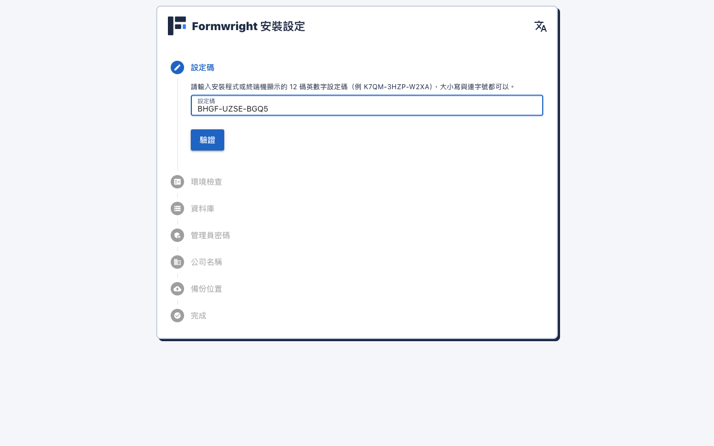
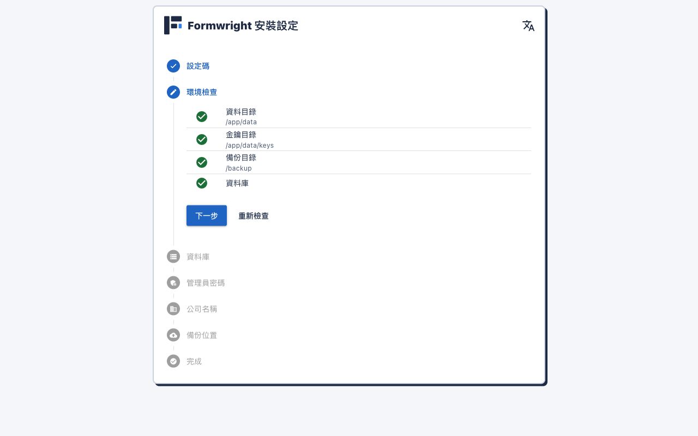
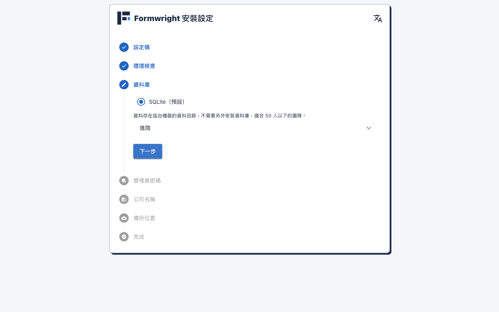
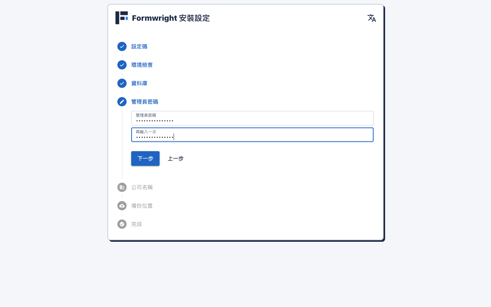
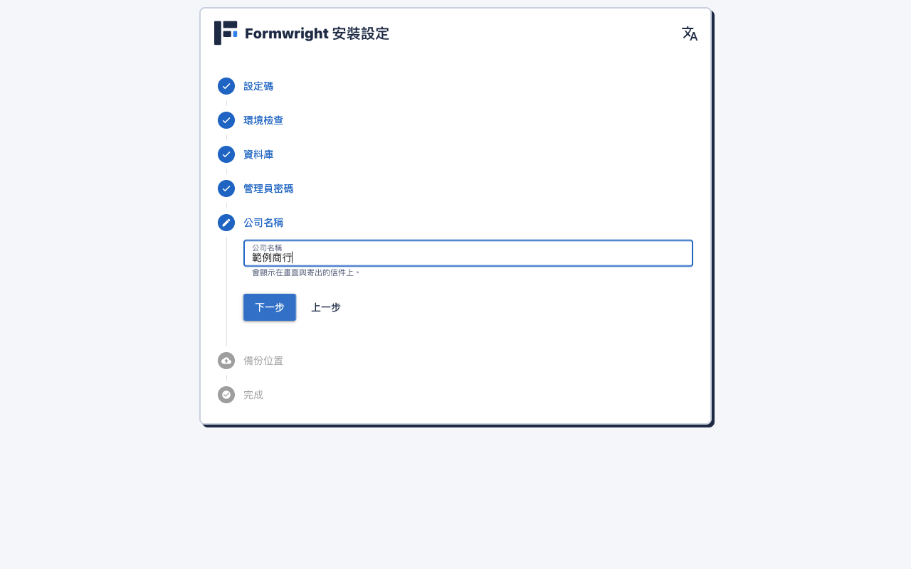
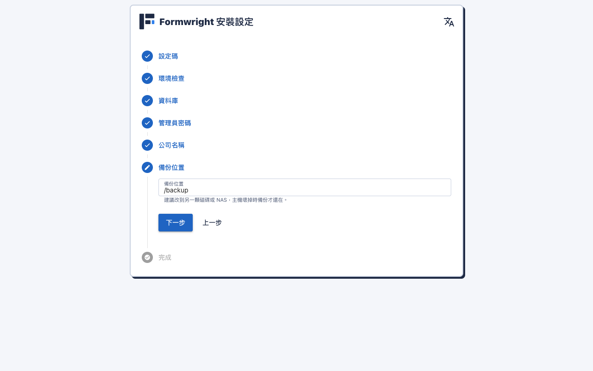
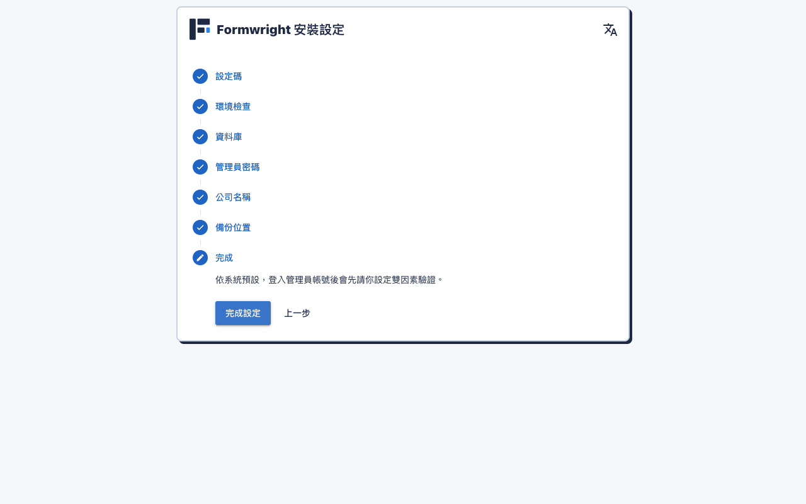
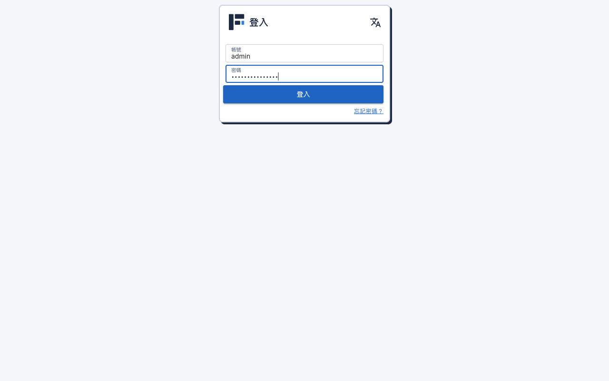
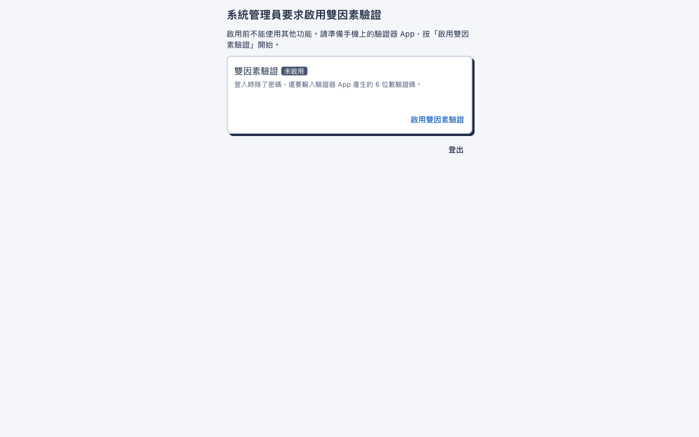

# Docker 安裝教學（新手版）

這份教學帶你用 Docker 把 Formwright（表匠）裝在一台電腦或主機上，讓公司同事用瀏覽器使用。只要照著「看到什麼 → 按哪裡／貼什麼」一步步做，指令一行一行貼上就好。

> 目前只有**預發版**（`v0.1.0-rc.2`，試用版本）。指令與畫面以這個版本為準；正式版發出後，下載網址會改成「最新版」，本文兩種網址都列出。

**這是什麼**：Docker 是在電腦裡跑「打包好的程式」的工具。Formwright 會在裡面跑成一個容器，資料庫已經包在裡面，不用另外安裝。沒聽過 Docker、只想裝在一台 Windows 或 Ubuntu 上的話，用 [Windows 安裝教學](install-windows.md)或 [Ubuntu 安裝教學](install-ubuntu.md)比較簡單。

## 先準備好這些

- 一台要常開的電腦或主機，**x86_64**（一般 Intel／AMD 的 64 位元電腦），同事才連得上。
- 已經裝好 Docker，而且你能操作它：
  - **Windows、Mac**：Docker Desktop。安裝方式看官方頁面：[Windows](https://docs.docker.com/desktop/setup/install/windows-install/)、[Mac](https://docs.docker.com/desktop/setup/install/mac-install/)。
  - **Linux**：Docker Engine 加上 compose plugin。看官方頁面：[Docker Engine](https://docs.docker.com/engine/install/)、[compose plugin](https://docs.docker.com/compose/install/linux/)。
- **Apple Silicon（M 系列晶片）的 Mac**：Formwright 只提供 x86_64 的映像，要靠模擬執行，**速度比較慢**，而且要多做第 2 節最後的一個步驟。適合試用，不建議當公司正式主機。
- 這台電腦能連上網路（要下載 Formwright 的映像，解開後約 370 MB；不需要任何帳號登入）。
- 一支手機，先裝好驗證器 App（Google Authenticator 或 Microsoft Authenticator 都可以）。管理員登入時一定會用到。
- 一支筆或一個記事本，中途要抄一組「設定碼」。

## 1. 打開指令視窗，確認 Docker 可以用

- **Windows**：先打開 Docker Desktop，等它啟動完成。按鍵盤的 **Windows 鍵**，輸入 `powershell`，按 **Enter**。本文的 Windows 指令都貼在這個 PowerShell 視窗（不是「命令提示字元」）。
- **Mac**：先打開 Docker Desktop，再打開「終端機」App。
- **Linux**：打開終端機，或用 SSH 登入主機。

貼上這一行，按 **Enter**：

```
docker compose version
```

看到 `Docker Compose version v…` 就可以繼續。如果說找不到指令，Docker 還沒裝好。

> **Linux**：如果出現 `permission denied`，代表你的帳號沒有 Docker 權限，本文每個 `docker` 指令前面加 `sudo`。

## 2. 建資料夾、下載設定檔

Formwright 只需要一個檔案 `docker-compose.yml`。先建一個資料夾放它，**以後所有指令都要在這個資料夾裡執行**。

**Windows（PowerShell）**，一行一行貼：

```powershell
mkdir $HOME\formwright
```

```powershell
cd $HOME\formwright
```

```powershell
curl.exe -fLo docker-compose.yml https://github.com/KerryHuang/formwright/releases/download/v0.1.0-rc.2/docker-compose.yml
```

**Linux、Mac**，一行一行貼：

```bash
mkdir -p ~/formwright
```

```bash
cd ~/formwright
```

```bash
curl -fLo docker-compose.yml https://github.com/KerryHuang/formwright/releases/download/v0.1.0-rc.2/docker-compose.yml
```

（Linux 說找不到 `curl` 時，Ubuntu 用 `sudo apt update && sudo apt install -y curl` 安裝。）

**正式版發出後**，下載網址改成 `https://github.com/KerryHuang/formwright/releases/latest/download/docker-compose.yml`（現在還沒有正式版，這個網址打不開）。

**只有 Apple Silicon 的 Mac 要做**：在同一個資料夾貼上這一行，告訴 Docker 用模擬方式跑。沒做的話，下一步會出現 `no matching manifest for linux/arm64/v8`。

```bash
printf 'services:\n  formwright:\n    platform: linux/amd64\n' > docker-compose.override.yml
```

這個小檔案要留著，以後升級也靠它。

## 3. 啟動

```
docker compose up -d
```

第一次會先下載映像，要等一下。最後幾行出現 `Started` 就是啟動了。約 30 秒後網頁才打得開。

## 4. 抄下設定碼

貼上：

```
docker compose logs formwright
```

畫面會跑出很多行。**只要看最前面這一行**，後面一堆 `{"Timestamp": …` 開頭的英文（JSON 格式的紀錄）都不用管：

```
formwright-1  | FORMWRIGHT_SETUP_CODE=K7QM-3HZP-W2XA
```

`=` 後面那串就是**設定碼**（上面是範例，你的會不一樣），12 個英文字母與數字，分成三組。請抄下來；大小寫、有沒有中間的橫線都沒關係，但字要抄對。畫面太長找不到時往上捲，或看[常見問題](#常見問題)。

## 5. 打開網頁，跑設定精靈（共 7 步）

在**這台電腦**打開瀏覽器，輸入：

```
http://localhost:8080
```

（沒有畫面的 Linux 主機，從同網路的另一台電腦輸入 `http://主機的 IP:8080`，IP 查法見第 7 節。）

瀏覽器會自動轉到「Formwright 安裝設定」頁，由上往下一步一步做。右上角的「文／A」語言圖示可以換語言。

**第 1 步：設定碼。** 輸入剛才抄的設定碼，按**驗證**。輸入錯了會顯示「設定碼不正確，請重新輸入。」。



**第 2 步：環境檢查。** 列出「資料目錄」「金鑰目錄」「備份目錄」「資料庫」，每一項前面都該是綠色打勾，然後按**下一步**。有紅色時「下一步」按不了，照紅字說明處理後按**重新檢查**。



**第 3 步：資料庫。** 預設「SQLite（預設）」，不用另外安裝任何東西，適合 50 人以下的公司。直接按**下一步**。



**第 4 步：管理員密碼。** 輸入兩次要用的密碼（至少 8 個字元），按**下一步**。這是管理員帳號 `admin` 的密碼，請記好。



**第 5 步：公司名稱。** 輸入公司名稱（例如「範例商行」），會顯示在畫面與系統寄出的信件上，不能空白。按**下一步**。



**第 6 步：備份位置。** **保留預設的 `/backup`，直接按下一步，不要改。** `/backup` 是 Docker 另外保存的空間（volume），升級、重建容器都還在；填成其他路徑（例如 Windows 的 `D:\Backup`，或容器裡別的資料夾）沒有對應的保存空間，輕則被擋下，重則下次升級時備份整個消失。備份和資料放在同一台電腦的問題，用[把備份複製到別的地方](#把備份複製到別的地方)處理。



**第 7 步：完成。** 按**完成設定**。站台會自動重新啟動，畫面等到服務回來後自動跳到登入頁，通常不到一分鐘；超過兩分鐘沒動就按**重新整理**。精靈只能跑一次，完成後再開設定頁只會回到登入頁。



每一步的更詳細說明，見 [Windows 教學的精靈章節](install-windows.md#5-瀏覽器裡的設定精靈共-7-步)（畫面一樣）。

## 6. 第一次登入與雙因素驗證

1. 帳號輸入 `admin`，密碼輸入第 4 步設定的密碼，按**登入**。這次不會再要求改密碼。

   

2. 管理員一定要設定雙因素驗證（登入時除了密碼，還要輸入手機 App 上每 30 秒變一次的 6 位數字）。看到「系統管理員要求啟用雙因素驗證」，按**啟用雙因素驗證**，輸入目前密碼，用手機的驗證器 App 掃描畫面上的 QR 碼，輸入 App 顯示的 6 位數字，按**完成綁定**。

   

3. 最後出現 10 組**復原碼，只會顯示這一次**。手機遺失時，每一組可以代替 6 位數字登入一次。請抄下或印出來，放在安全的地方（例如保險箱），再按**我已保存**。

完整的逐步說明與每一張截圖，見 [Windows 教學的雙因素章節](install-windows.md#設定雙因素驗證必做)（畫面一樣）。

## 7. 讓同事的電腦連進來

同事不用安裝任何東西，在瀏覽器輸入 `http://這台主機的 IP:8080/`。

**查這台主機的 IP**：

- **Windows**：在 PowerShell 輸入 `ipconfig`，找目前上網那張網卡（「乙太網路卡」或「Wi-Fi」）底下的「IPv4 位址」。如果有好幾組，通常是上網用的那一張。
- **Linux**：輸入 `hostname -I`，通常第一組數字就是。
- **Mac**：「系統設定 → 網路」，點目前的連線看 IP 位址。

例如查到 `192.0.2.20`，同事就開 `http://192.0.2.20:8080/`。

**注意**：

- 設定檔把連接埠開在主機的所有網路介面上，沒有限制來源。Formwright 只給公司內網使用，不要把主機直接暴露在網路上；要從外面連進來請另找 VPN。
- **Linux 主機**：Docker 發布的連接埠可能繞過 ufw 防火牆，不要只靠 ufw 判定外面已經連不進來；要限制來源，請網管在 Docker 適用的轉送規則或上游防火牆處理（[Docker 官方說明](https://docs.docker.com/engine/network/packet-filtering-firewalls/#docker-and-ufw)）。
- 同事連不上時，先確認同一個網路、IP 正確、網址有 `:8080`，再檢查這台主機的防火牆有沒有放行 8080。本教學尚未實測從別台電腦連 Docker 版，防火牆的處理請找網管。
- 主機的 IP 如果會變，同事的網址就會失效，請網管替它固定 IP。

## 8. 日常

- **看有沒有在跑**（在放設定檔的資料夾）：`docker compose ps`，`STATUS` 欄是 `Up …` 就是正常。
- **看紀錄**：`docker compose logs formwright`。
- **Windows、Mac 的 Docker Desktop 要開著**。Docker 沒在跑，Formwright 就連不上。
- **重新開機**：設定檔寫了 `restart: unless-stopped`，Docker 起來後 Formwright 會跟著起來（你自己用 `docker compose stop` 停掉的除外）。所以 Docker Desktop 要在它的設定（Settings）裡開啟「自動啟動」的選項；設好後實際重開一次電腦、登入，確認網頁打得開。主機也不要設成自動睡眠。
- **自動備份**：預設每天凌晨 2 點備份一次，自動備份保留最近 7 份（在系統裡按「立即備份」做的備份預設保留 7 天）。精靈完成後馬上就有第一份。查看清單：

  ```
  docker compose run --rm --no-deps --entrypoint ls formwright /backup/sets
  ```

  前面幾行 `Container … Creating`、`Created` 是正常訊息，後面像 `20261127T071352Z-7993a89e` 的每一行是一份備份（開頭是日期時間，用的是世界標準時間，比台灣慢 8 小時）。細節見[部署指南的產品內備份](deploy.md#產品內備份)。

### 把備份複製到別的地方

備份預設和資料放在同一台電腦，硬碟壞掉會一起不見。請定期（例如每週）把整個備份複製出來，再搬到外接硬碟或公司的網路硬碟。在放設定檔的資料夾執行：

```
docker compose cp formwright:/backup backup-copy
```

資料夾裡會多出 `backup-copy`。**整個資料夾一起帶走**：資料庫在 `sets` 裡，附件在 `attachments` 裡，只拿其中一部分，還原時會缺資料。下次複製前把舊的改名（例如加日期）。

這份複本的用途是讓資料庫和附件在這台電腦之外也有一份。**它不能直接把系統搬到另一台電腦**：複本不含登入金鑰和設定檔，目前也沒有從複本還原到新電腦的逐步說明（見下面的[常見問題](#常見問題)）。

## 9. 升級到新版

1. 在同一個資料夾，用第 2 節的下載指令下載**新版**的 `docker-compose.yml` 覆蓋舊檔（網址裡的 `v0.1.0-rc.2` 換成新版號；正式版用 `latest` 的網址）。只下載這一個檔案；`.env`、`docker-compose.override.yml` 有的話留著。
2. 執行：

   ```
   docker compose up -d
   ```

它會下載新版、換掉舊容器；新版第一次啟動時會**先自動備份**，再升級資料庫。你的資料與設定都不動。完成前網頁會暫時連不上。如果停在「系統維護中」頁，見下面的常見問題。

只執行 `docker compose pull` 不會升級，因為設定檔裡寫死了版號，一定要先換新的設定檔。

## 常見問題

**設定碼找不到**

只要還沒跑完精靈，設定碼就一直存著。直接讀出來：

```
docker compose run --rm --no-deps --entrypoint cat formwright /app/data/setup-code
```

最後一行就是設定碼。精靈跑完後這個檔案會刪除，也就不需要設定碼了。

**啟動時出現 `port is already allocated`（或其他寫到 8080 連接埠被占用的錯誤）**

8080 被別的程式用掉了，改用別的號碼，例如 8090。在放設定檔的資料夾建一個叫 `.env` 的小檔案：

Windows（PowerShell）：

```powershell
Set-Content .env "FORMWRIGHT_PORT=8090"
```

Linux、Mac：

```bash
echo "FORMWRIGHT_PORT=8090" > .env
```

再執行 `docker compose up -d`，之後網址改用 `http://localhost:8090`。這個檔案要留著。

**網頁打不開**

`docker compose ps` 看有沒有 `Up`。沒有的話確認 Docker（Desktop）有開著，再執行 `docker compose up -d`；仍然不行就看 `docker compose logs formwright`。網址要用 `http`（不是 `https`）。

**升級後停在「系統維護中」頁**

升級前備份失敗或備份位置有問題，所以沒有升級，資料庫維持原狀。照頁面上的「處理方式」做，說明見[操作手冊](manual.md#升級與移除安裝版)。

**怎麼移除**

- **只移除程式、保留資料**（之後 `docker compose up -d` 可以接回）：

  ```
  docker compose down
  ```

- **連資料和備份一起全部刪掉，無法復原**：

  ```
  docker compose down -v
  ```

  執行前先確認真的不要了；要留備份請先[複製出來](#把備份複製到別的地方)。

兩種做法都**不會刪掉下載的映像**，要騰出空間再執行（版號換成你裝過的）：

```
docker rmi ghcr.io/kerryhuang/formwright:0.1.0-rc.2
```

**電腦壞了、資料不見了，怎麼辦**

- **同一台電腦、Formwright 原本的安裝和資料空間（volume）都還在**，只是資料改壞或資料庫壞了：請找維護的人員照[部署指南的 Docker 還原步驟](deploy.md#安裝版的還原)處理。
- **換電腦、硬碟壞掉，或資料空間（volume）被刪掉**：只要手上有複製到電腦以外的備份（例如上面的 `backup-copy`），就可以在新電腦重新安裝後還原，步驟見[部署指南的「換主機或資料遺失」](deploy.md#換主機或資料遺失)，請找維護的人員照著做。產品備份不含登入金鑰，沒有另外保存金鑰時，還原後大家要重新登入、雙因素要用復原碼重新綁定；想避免的話，平時照同一節的「選用：另外保存登入金鑰」做。

## 接著看

- 進階設定（環境變數、PostgreSQL、升級與還原細節）：[部署指南](deploy.md#安裝版windowsubuntudocker-compose)
- 設定精靈每一步的完整說明：[操作手冊](manual.md#安裝版的設定精靈)
- 雙因素驗證的完整說明：[操作手冊](manual.md#雙因素驗證)
