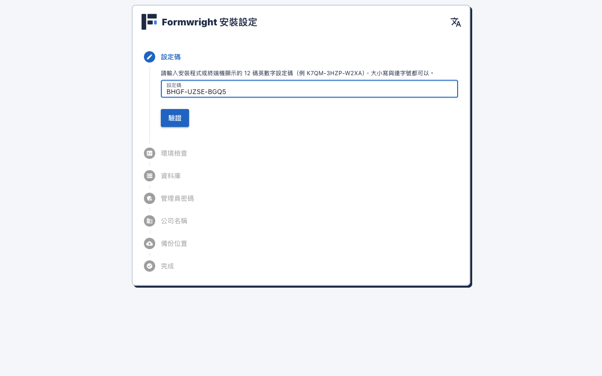
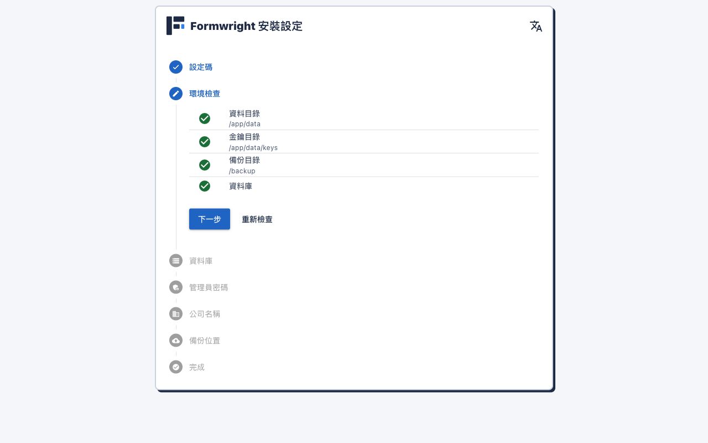
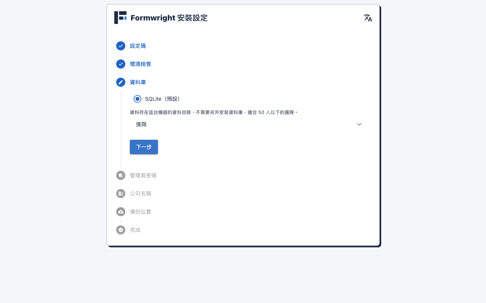
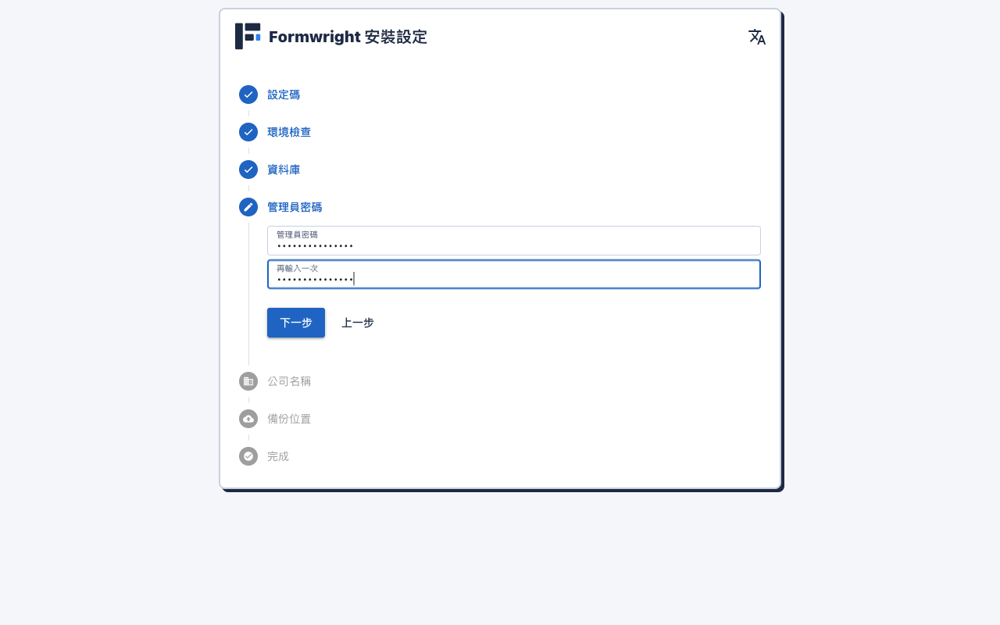
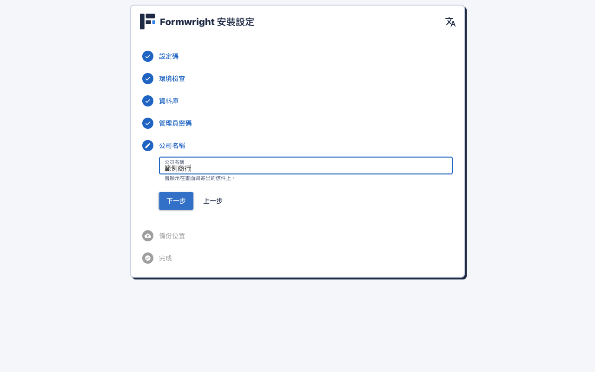
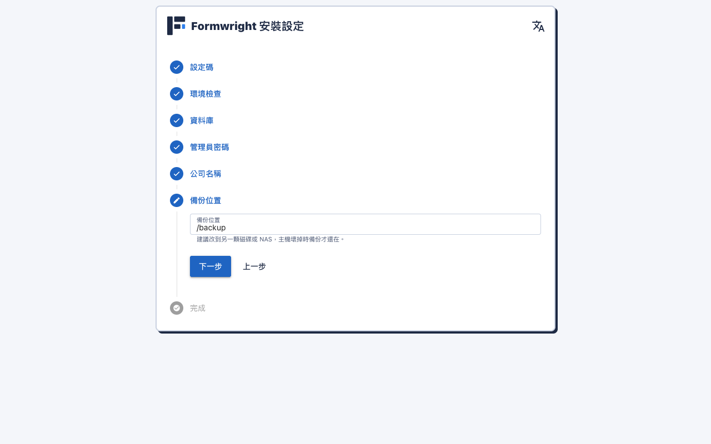
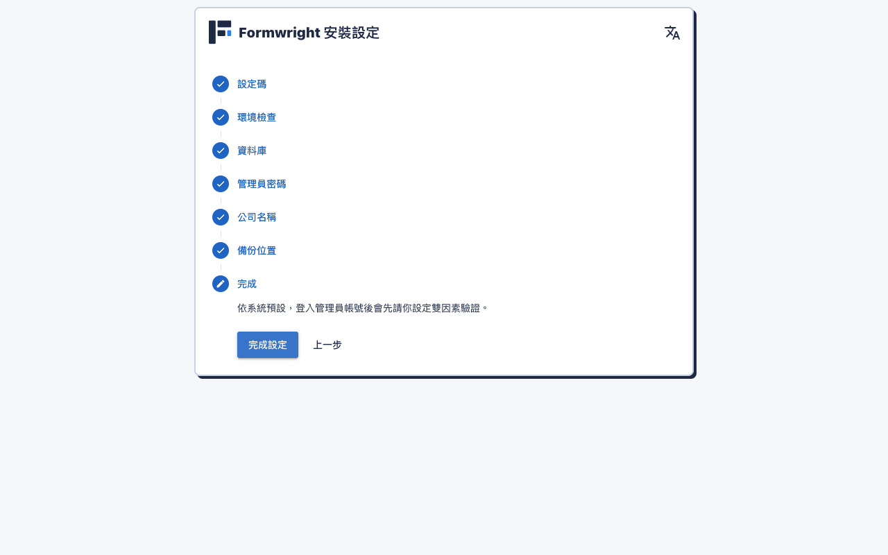
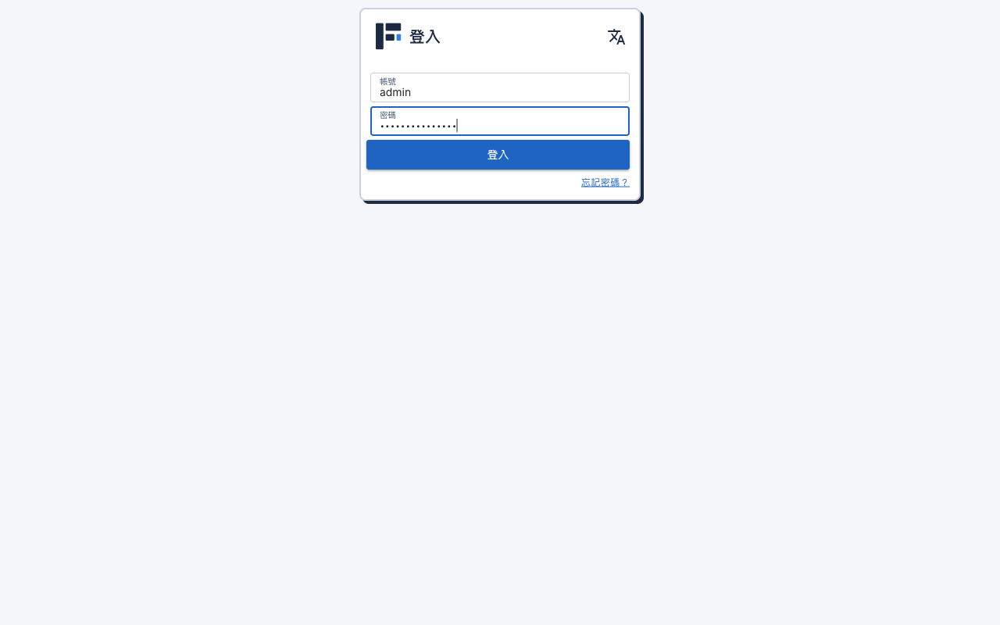
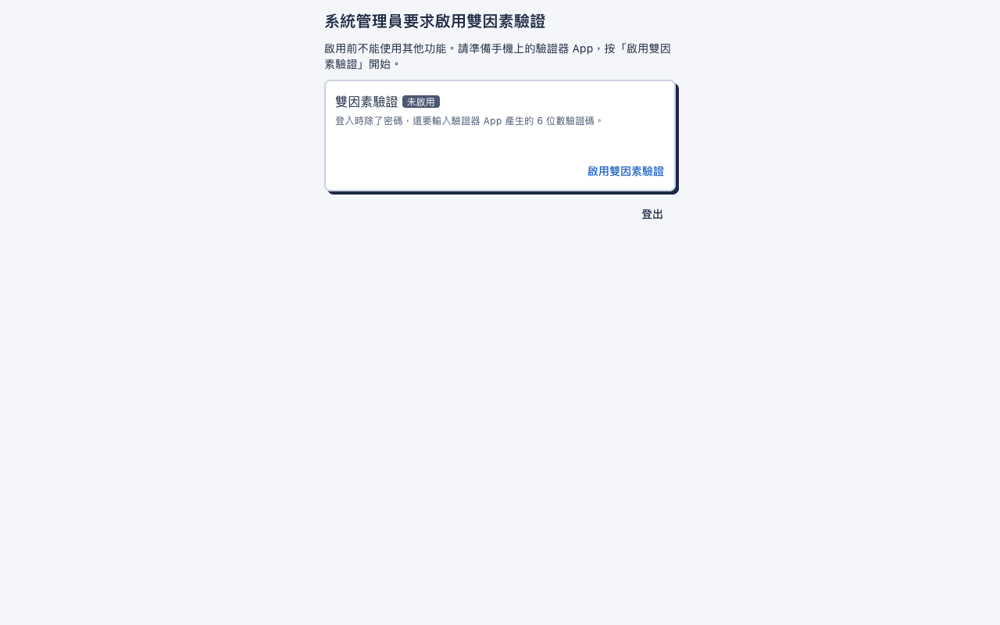

# Ubuntu 安裝教學（新手版）

這份教學帶你把 Formwright（表匠）裝在一台 Ubuntu 主機上，讓公司同事用瀏覽器使用。你不需要懂 Linux，只要能把本文的指令一行一行貼進終端機。

> 目前只有**預發版**（`v0.1.0-rc.2`，試用版本）。指令與畫面以這個版本為準；正式版發出後，安裝網址會改成「最新版」，本文兩種網址都列出。

**這是什麼**：安裝腳本會把 Formwright 裝成一個 systemd 服務，開機自動啟動，不需要另外安裝資料庫或網頁伺服器。裝好後在瀏覽器完成設定精靈就能用。

Windows 電腦請看 [Windows 安裝教學](install-windows.md)；用 Docker 安裝請看 [Docker 安裝教學](install-docker.md)。

## 先準備好這些

- 一台 **Ubuntu 22.04 或 24.04、64 位元（x86_64）** 的電腦或伺服器，要常開，同事才連得上。其他版本或其他 Linux 會被腳本拒絕。
- 一個**能用 `sudo` 的帳號**（會問你密碼的那種管理員權限）。
- 這台電腦能連上網路（要從 GitHub 下載安裝檔）。
- 一支手機，先裝好驗證器 App（Google Authenticator 或 Microsoft Authenticator 都可以）。管理員登入時一定會用到。
- 一支筆或一個記事本，中途要抄一組「設定碼」。
- 大約 15 分鐘。

## 1. 打開終端機

- **桌面版 Ubuntu**：同時按 **Ctrl + Alt + T**，會跳出一個黑色視窗，這就是終端機。
- **伺服器版 Ubuntu**：從自己的電腦用 SSH 登入（`ssh 你的帳號@伺服器的 IP`），登入後看到的畫面就是終端機。

以下所有指令，都是貼進終端機後按 **Enter**。

## 2. 貼上安裝指令

**先確認有沒有 `curl`**（下載用的工具）。貼這一行：

```bash
command -v curl
```

如果印出一個路徑（例如 `/usr/bin/curl`），就有，直接往下。如果什麼都沒印，先安裝它（會問 sudo 密碼）：

```bash
sudo apt update && sudo apt install -y curl
```

**預發版（目前）**：

```bash
curl -fsSL https://github.com/KerryHuang/formwright/releases/download/v0.1.0-rc.2/install.sh | sudo bash -s -- --lang zh-TW
```

**正式版發出後**，改用這一行（永遠抓最新版）：

```bash
curl -fsSL https://github.com/KerryHuang/formwright/releases/latest/download/install.sh | sudo bash -s -- --lang zh-TW
```

貼上、按 **Enter** 之後：

1. 系統可能問你的密碼（`[sudo] password for ...`）。輸入時畫面不會顯示任何字，這是正常的，輸入完按 **Enter**。
2. 腳本開始下載並安裝，過程不用操作，通常不到一分鐘。

上面的指令尾端的 `--lang zh-TW` 是讓腳本固定用繁體中文說話（不加的話，只有系統語言是 `zh_TW`、`zh_HK`、`zh_MO` 才顯示繁體中文，其他一律英文，下面的輸出就對不上了）。

## 3. 看懂輸出、抄下設定碼

裝好時，終端機會印出像這樣的內容（IP 與設定碼每台都不一樣，下面是範例）：

```
正在安裝 Formwright 0.1.0-rc.2 …
Created symlink /etc/systemd/system/multi-user.target.wants/formwright.service → /etc/systemd/system/formwright.service.
請用瀏覽器開啟：http://192.0.2.20:8080/
FORMWRIGHT_SETUP_CODE=K7QM-3HZP-W2XA
設定碼（精靈第一步要輸入）：K7QM-3HZP-W2XA
```

重點只有兩樣，請都抄下來：

- **網址**：「請用瀏覽器開啟：」後面那串，例如 `http://192.0.2.20:8080/`。
- **設定碼**：最後一行，12 個英文字母與數字，分成三組，例如 `K7QM-3HZP-W2XA`。大小寫、有沒有中間的橫線都沒關係，但字要抄對（設定碼已經避開容易看錯的 `0`、`1`、`I`、`O`）。

「Created symlink …」那行是系統設定開機自動啟動的訊息，不是錯誤。

如果終端機最後什麼都沒印、或印出錯誤，請看下面的[常見問題](#常見問題)。

## 4. 打開網址

- **在這台 Ubuntu 上**：開瀏覽器，輸入 `http://localhost:8080`。
- **在別台電腦上**：輸入剛才抄的網址（有 IP 的那個）。如果忘了 IP，在這台 Ubuntu 的終端機輸入 `hostname -I`，印出來的第一組數字就是 IP，例如 `192.0.2.20`，網址就是 `http://192.0.2.20:8080/`。

瀏覽器會自動轉到「Formwright 安裝設定」頁。這個頁面的 7 個步驟跟 Windows 版完全一樣，下面照順序說一次。

## 5. 瀏覽器裡的設定精靈（共 7 步）

> 下面的截圖是用 Docker 示範，所以「資料目錄」「備份目錄」顯示 `/app/data`、`/backup`；你在 Ubuntu 上會看到 `/var/lib/formwright/data`、`/var/lib/formwright/backup`。其他畫面與按鈕完全一樣。

**第 1 步：設定碼。** 輸入剛才抄的設定碼，按**驗證**。輸入錯了會顯示「設定碼不正確，請重新輸入。」。



**第 2 步：環境檢查。** 列出「資料目錄」「金鑰目錄」「備份目錄」「資料庫」，每一項前面都該是綠色打勾，然後按**下一步**。有紅色時「下一步」按不了，照紅字說明處理後按**重新檢查**。



**第 3 步：資料庫。** 預設「SQLite（預設）」，不用另外安裝任何東西，適合 50 人以下的公司。直接按**下一步**。



**第 4 步：管理員密碼。** 輸入兩次要用的密碼（至少 8 個字元），按**下一步**。這是管理員帳號 `admin` 的密碼，請記好。



**第 5 步：公司名稱。** 輸入公司名稱（例如「範例商行」），會顯示在畫面與系統寄出的信件上，不能空白。按**下一步**。



**第 6 步：備份位置。** 預設是 `/var/lib/formwright/backup`，跟資料在同一台機器的同一顆硬碟。建議改到**另一顆磁碟**，或**已經掛載好的網路硬碟（NAS）**，否則硬碟壞掉時備份會一起不見。填完整的路徑（例如 `/mnt/backup/formwright`），而且要讓服務帳號 `formwright` 能寫入。備份位置不能跟資料、金鑰、程式所在的資料夾重疊。填好按**下一步**；如果出現紅字（例如「這個位置無法寫入」），先照紅字處理（路徑要存在、服務帳號 `formwright` 要有寫入權限）再按一次**下一步**。暫時沒有另一顆磁碟或網路硬碟時，可以先保留預設路徑直接按**下一步**，但請盡快安排。



**第 7 步：完成。** 按**完成設定**。站台會自動重新啟動，畫面等到服務回來後自動跳到登入頁，通常不到一分鐘；超過兩分鐘沒動就按**重新整理**。精靈只能跑一次，完成後再開設定頁只會回到登入頁。



每一步的更詳細說明，見 [Windows 教學的精靈章節](install-windows.md#5-瀏覽器裡的設定精靈共-7-步)（畫面一樣）。

## 6. 第一次登入與雙因素驗證

1. 帳號輸入 `admin`，密碼輸入第 4 步設定的密碼，按**登入**。這次不會再要求改密碼。

   

2. 管理員一定要設定雙因素驗證（登入時除了密碼，還要輸入手機 App 上每 30 秒變一次的 6 位數字）。看到「系統管理員要求啟用雙因素驗證」，按**啟用雙因素驗證**，輸入目前密碼，用手機的驗證器 App 掃描畫面上的 QR 碼，輸入 App 顯示的 6 位數字，按**完成綁定**。

   

3. 最後出現 10 組**復原碼，只會顯示這一次**。手機遺失時，每一組可以代替 6 位數字登入一次。請抄下或印出來，放在安全的地方（例如保險箱），再按**我已保存**。

完整的逐步說明與每一張截圖，見 [Windows 教學的雙因素章節](install-windows.md#設定雙因素驗證必做)（畫面一樣）。

## 7. 讓同事的電腦連進來

同事不用安裝任何東西，在瀏覽器輸入 `http://這台主機的 IP:8080/`（IP 用 `hostname -I` 查）即可。

**防火牆（ufw）**：

- 如果這台主機的 **ufw 防火牆有啟用**（用 `sudo ufw status` 看，第一行是 `Status: active`），安裝腳本會自動執行 `ufw allow 8080/tcp`，放行這個連接埠。這條規則**不限來源**，只要連得到這台主機的人都能連到登入頁，所以請把主機放在公司內網，不要直接暴露在網路上。
- 如果 ufw **沒有啟用**，腳本不會動任何防火牆設定；不過雲端主機的安全群組、路由器等其他防火牆它也不會處理，要自己放行。
- **升級**時腳本不會重新開埠。如果你改過連接埠，要自己執行 `sudo ufw allow <新埠>/tcp`（做法見[部署指南](deploy.md#改連接埠)）。

Formwright 只給公司內網使用。要從外面連進來，請另找 VPN，不要直接開放到網路上。

## 8. 日常：你不用做什麼

- **開機自動啟動**：服務是 systemd 的 `formwright`，已設成開機自動啟動。想確認狀態：

  ```bash
  sudo systemctl status formwright
  ```

  看到綠色的 `active (running)` 就是正常；按 **q** 離開。
- **自動備份**：預設每天凌晨 2 點備份一次，自動備份保留最近 7 份（在系統裡按「立即備份」做的備份預設保留 7 天），放在你在精靈第 6 步設定的位置，每一份在其下 `sets/` 資料夾裡的一個資料夾（預設是 `/var/lib/formwright/backup/sets/`）。精靈完成後不久就會有第一份。備份資料夾只有 root 與服務帳號看得到，用 `sudo ls /var/lib/formwright/backup/sets/` 查看。細節見[部署指南的產品內備份](deploy.md#產品內備份)。
- **看 log**：`sudo journalctl -u formwright`（按 **q** 離開；加 `-e` 直接跳到最後）。
- 請偶爾（例如每月）看一下備份位置，確認有新的備份在長。
- **搬備份要整個備份根目錄一起帶**：資料庫與清單在 `sets/` 裡，附件實體放在同一個備份根目錄下的 `attachments/`，被所有備份共用。只帶 `sets/` 裡的某一份，還原時會缺附件。

## 常見問題

**網頁打不開**

- 先確認服務有在跑：`sudo systemctl is-active formwright`，要印出 `active`。沒有的話 `sudo systemctl start formwright`，再用 `sudo journalctl -u formwright -e` 看原因。
- 網址要用 `http`（不是 `https`），連接埠要對（預設 `:8080`）。
- 別台電腦連不上時：確認兩台在同一個內網、IP 沒變、這台主機的防火牆有放行（見第 7 節）。

**設定碼沒抄到或忘了**

只要還沒跑完設定精靈，設定碼就一直存在主機裡，重新啟動也不會變。在這台主機的終端機輸入：

```bash
sudo cat /var/lib/formwright/data/setup-code
```

印出來的 12 個字母數字就是設定碼。精靈跑完之後這個檔案會自動刪除。（重新執行安裝指令不會再顯示設定碼，因為安裝腳本只在全新安裝時才顯示它。）

**怎麼升級到新版**

重新貼一次第 2 節的安裝指令（預發版用有版號的網址，正式版用 `latest` 的網址，尾端一樣帶 `--lang zh-TW`）。腳本偵測到已安裝，會先停止服務、用舊版做一次備份，備份成功才換成新版，你的資料與設定都不動。

**升級成功時畫面長什麼樣子？** 大致如下（版號依實際版本）：

```
正在升級 Formwright：<舊版號> → <新版號>
升級前先備份資料 …
升級前備份完成。
已升級到版本 <新版號>。
```

看到「已升級到版本 …」就是成功。0.1.0-rc.1、0.1.0-rc.2 的安裝腳本會在中間印出一大段英文 JSON，同樣只要看最後有沒有「已升級到版本 …」。

**升級中止了怎麼辦？** 升級前備份失敗時，腳本會中止並保持舊版運作（結束碼 20）；備份位置沒有設定或設定無效時也會中止（結束碼 21），先設好備份位置再重跑。兩種情況畫面都會印出一行 `FORMWRIGHT_BACKUP_…` 代碼與紀錄檔位置。完整紀錄（英文的 JSON，是備份程式的原始輸出）在 `/var/lib/formwright/logs/`，每次升級一個 `upgrade-<UTC 時間>-<隨機碼>.log`，只有 root 讀得到（不要改這個資料夾的擁有者或權限，改過的話下次升級會刪掉重建）。照畫面上的指令查看（按 **q** 離開）：

```bash
sudo ls /var/lib/formwright/logs/
sudo less /var/lib/formwright/logs/upgrade-<檔名其餘部分>.log
```

**`remove` 和 `purge` 差在哪裡？怎麼解除安裝？**

- **`remove`（保留資料）**：只移除程式與服務，資料、設定與備份都保留，之後可以重新安裝接回。

  ```bash
  curl -fsSL https://github.com/KerryHuang/formwright/releases/download/v0.1.0-rc.2/install.sh | sudo bash -s -- remove --lang zh-TW
  ```

- **`purge`（全部刪除，無法復原）**：連資料、設定、備份、升級紀錄（`/var/lib/formwright/logs/`）與服務帳號一起刪。會問你要不要確認，要輸入 `yes`（只輸入 `y` 不算）。

  ```bash
  curl -fsSL https://github.com/KerryHuang/formwright/releases/download/v0.1.0-rc.2/install.sh | sudo bash -s -- purge --lang zh-TW
  ```

  最後會印出 `已移除程式、服務、資料與設定。`。如果是在沒有終端機的環境（例如被別的腳本呼叫）執行，要在 `purge` 後面加 `--yes`。備份位置設在預設資料夾之外時，不會被刪，腳本會把路徑列出來。

除非確定不再需要任何資料，否則請選 `remove`。正式版發出後，上面兩行的網址換成 `releases/latest/download/install.sh` 那種。

**`curl: command not found`（找不到 curl）**

表示這台主機沒有裝 `curl`。執行 `sudo apt update && sudo apt install -y curl` 之後，再貼一次安裝指令。

**怎麼改連接埠**

進階設定，見[部署指南](deploy.md#改連接埠)。

**電腦壞了、資料不見了，怎麼辦**

只要備份還在，資料可以還原。請找維護的人員照[部署指南的還原步驟](deploy.md#安裝版的還原)處理；換電腦或硬碟壞掉時照[換主機或資料遺失](deploy.md#換主機或資料遺失)，先在新電腦重新安裝再放回備份。這也是第 6 步要把備份放在另一顆磁碟或網路硬碟的原因；備份只在這台電腦上時，請照同一節定期複製到別處。

**在 Windows 的 WSL 上試裝**

可以在 Windows 的 WSL2（Ubuntu 24.04）裡試裝這份教學，只是網路有些限制：

- 安裝輸出的位址（例如 `172.x.x.x`）是 WSL 內部的虛擬網路，不一定連得上。請在 **Windows 本機**的瀏覽器開 `http://localhost:8080`。
- 同網段的**別台電腦通常連不到** WSL 裡的服務，所以 WSL 只適合自己試用，不適合給同事用。
- WSL 預設沒有 ufw，所以不會有防火牆那一步。

## 接著看

- 進階的設定（改連接埠、環境變數、PostgreSQL）：[部署指南](deploy.md#安裝版windowsubuntudocker-compose)
- 設定精靈每一步的完整說明：[操作手冊](manual.md#安裝版的設定精靈)
- 雙因素驗證的完整說明：[操作手冊](manual.md#雙因素驗證)
