# Windows 安裝教學（新手版）

這份教學帶你把 Formwright（表匠）裝在一台 Windows 電腦上，讓公司同事用瀏覽器就能使用。不需要懂程式，照著「看到什麼 → 按哪裡」一步步做就好。

> 目前只有**預發版**（`v0.1.0-rc.2`，試用版本）。畫面與步驟以這個版本為準；正式版發出後，下載網址會改成「最新版」。

要裝在 Ubuntu 主機請看 [Ubuntu 安裝教學](install-ubuntu.md)；用 Docker 安裝請看 [Docker 安裝教學](install-docker.md)。

**這是什麼**：Formwright 裝好後會變成這台電腦上的一個 Windows 服務，開機自動啟動，不需要另外安裝 IIS 或資料庫。同事在自己的電腦用瀏覽器開這台電腦的網址就能使用。

## 先準備好這些

- 一台 Windows 10（版本 1809 以上）、Windows 11 或 Windows Server 2019 以上的電腦，64 位元。這台電腦要常開，同事才連得上。
- 你要能用「系統管理員」身分操作這台電腦（會問你密碼或要你按「是」的那種權限）。
- 一支手機，先裝好驗證器 App（Google Authenticator 或 Microsoft Authenticator 都可以）。管理員登入時一定會用到。
- 一支筆或一個記事本。中途會出現一組「設定碼」，要抄下來。
- 大約 15 分鐘。

## 1. 下載安裝檔

1. 用瀏覽器開 [Formwright 的 Releases 頁](https://github.com/KerryHuang/formwright/releases)。
2. 找到最上面的版本（目前是 `v0.1.0-rc.2`），往下捲到 **Assets** 區。
3. 點檔名 `Formwright-Setup-0.1.0-rc.2.exe`（檔案約 45 MB）下載。檔名中的版號會隨版本改變，開頭一定是 `Formwright-Setup-`。
4. 下載完成後，檔案通常在「下載」資料夾。

## 2. 執行安裝檔

1. 在檔案上按**滑鼠右鍵**，選**以系統管理員身分執行**。
2. 畫面可能跳出「使用者帳戶控制」，問你要不要允許這個應用程式變更你的裝置，按**是**。
3. **Windows 可能會擋住它**：出現藍色畫面，標題是「Windows 已保護您的電腦」，說「Microsoft Defender SmartScreen 已防止啟動無法辨識的應用程式」。這是因為安裝檔還沒有數位簽章，不代表有問題。處理方式：
   1. 按畫面上的**其他資訊**。
   2. 下面會多出一顆按鈕，按**仍要執行**。

   （要確認檔案沒被動過，請只從上面 Releases 頁下載。）

## 3. 安裝程式每一頁

安裝程式的語言跟著你的 Windows：Windows 是繁體中文就顯示繁體中文，其他語言一律顯示英文。下面以繁體中文為準，括號內是英文版的字樣。

| 你看到 | 要做什麼 |
|---|---|
| **連接埠**（Connection port），說明「選擇 Formwright 要使用的連接埠。」，欄位「連接埠（1–65535）：」已填 `8080` | 不確定就**不要改**。`8080` 已經有別的程式在用時才改成其他數字，例如 `8090`。填錯會跳出「連接埠必須是 1–65535 的整數。」 |
| 按鈕**安裝** | 按下去開始安裝 |
| **正在安裝** | 等它跑完，不用操作。它會複製檔案、建立 Windows 服務、設定防火牆，最後啟動服務並確認網站能開，通常不到一分鐘 |
| **設定碼**（Setup code），說明「請在瀏覽器設定精靈的第一步輸入這組設定碼。」 | 看下一節，**一定要抄下來** |

沒有選資料夾的頁面：程式固定裝在 `C:\Program Files\Formwright`，資料放在 `C:\ProgramData\Formwright`。

## 4. 抄下網址與設定碼

「設定碼」這一頁有兩樣東西：

- 一組大字的**設定碼**，12 個英文字母與數字，分成三組，像 `K7QM-3HZP-W2XA`（這是範例，你的會不一樣）。
- 一行「請用瀏覽器開啟：」後面接網址，像 `http://localhost:8080/`。

請把設定碼抄在紙上或記事本。大小寫、有沒有中間的橫線都沒關係，但字要抄對。設定碼已經去掉容易看錯的字（沒有 `0`、`1`、`I`、`O`）。

抄好之後按**下一步**，到最後一頁：

- 勾著「在瀏覽器開啟設定精靈」（預設就是勾的），按**完成**，瀏覽器會自動打開設定精靈。
- 如果沒有自動打開，自己在瀏覽器網址列輸入剛才抄的網址就可以。

## 5. 瀏覽器裡的設定精靈（共 7 步）

瀏覽器會開到「Formwright 安裝設定」頁，由上往下一步一步做。右上角的「文／A」語言圖示可以換語言。

> 下面的截圖是用另一種方式安裝（Docker）示範，所以「資料目錄」「備份目錄」顯示的是 `/app/data` 這類路徑；你在 Windows 上會看到 `C:\ProgramData\Formwright\...` 開頭的路徑。其他畫面與按鈕完全一樣。

### 第 1 步：設定碼

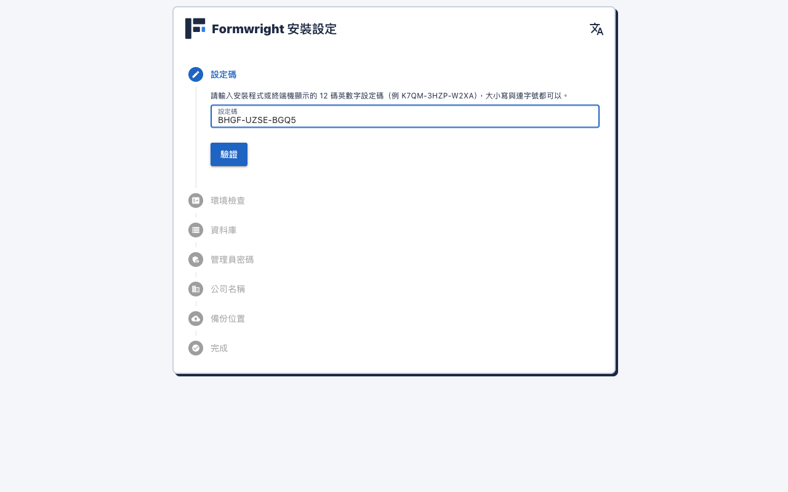

1. 在「設定碼」欄位輸入剛才抄的設定碼。
2. 按**驗證**。

輸入錯了會顯示「設定碼不正確，請重新輸入。」，後面的步驟不會出現，重新輸入就好。

### 第 2 步：環境檢查

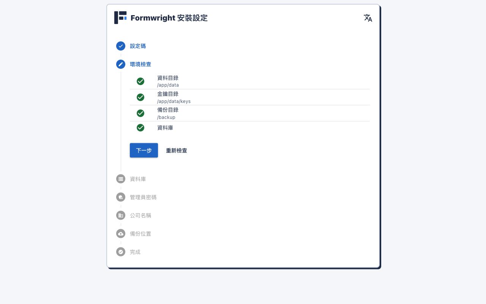

畫面會列出「資料目錄」「金鑰目錄」「備份目錄」「資料庫」，每一項前面都該是綠色打勾。

- 全部綠色：按**下一步**。
- 有紅色：「下一步」會按不了。照紅字說明處理（例如備份位置無法寫入）後，按**重新檢查**。看不懂紅字說什麼，請先不要繼續，把畫面拍下來找協助你的人。
- 如果紅字寫「這個位置已經有 Formwright 的資料，精靈不會覆蓋它」：表示這台電腦以前裝過、資料還在。請見下面的[常見問題](#常見問題)。

### 第 3 步：資料庫

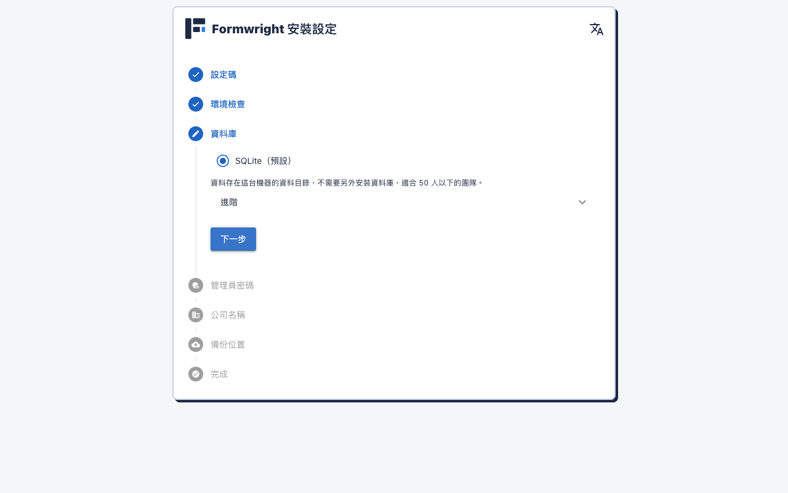

預設選的是「SQLite（預設）」，資料存在這台電腦上，不用另外安裝任何東西，適合 50 人以下的公司。**直接按下一步**。

（有專人維護 PostgreSQL 資料庫才需要展開「進階」，一般公司不用碰。）

### 第 4 步：管理員密碼

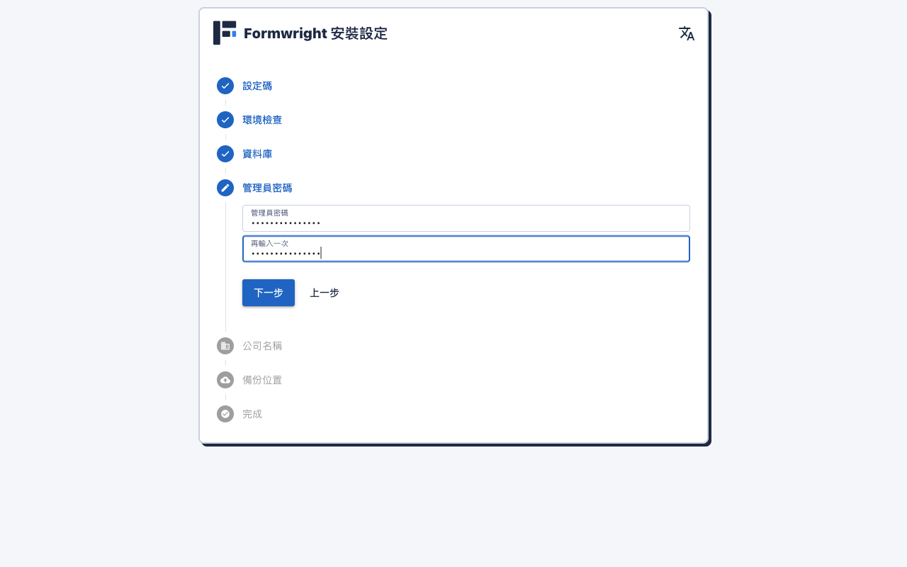

1. 「管理員密碼」輸入你要用的密碼，至少 8 個字元。
2. 「再輸入一次」再輸入同一組。
3. 按**下一步**。

這組密碼是管理員帳號 `admin` 的密碼，請記好（建議用密碼管理工具，或寫在放保險箱的紙上）。兩次不一樣會顯示「兩次輸入的密碼不一致。」；太短時，到最後一步會被退回這裡並說明至少要幾個字元。

### 第 5 步：公司名稱

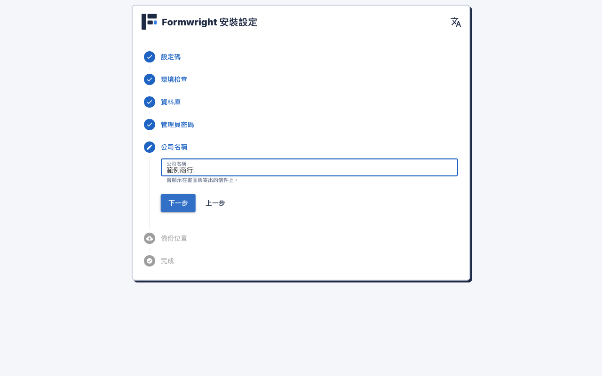

輸入你的公司名稱（例如「範例商行」），按**下一步**。這個名稱會顯示在畫面上與系統寄出的信件裡，不能空白。

### 第 6 步：備份位置

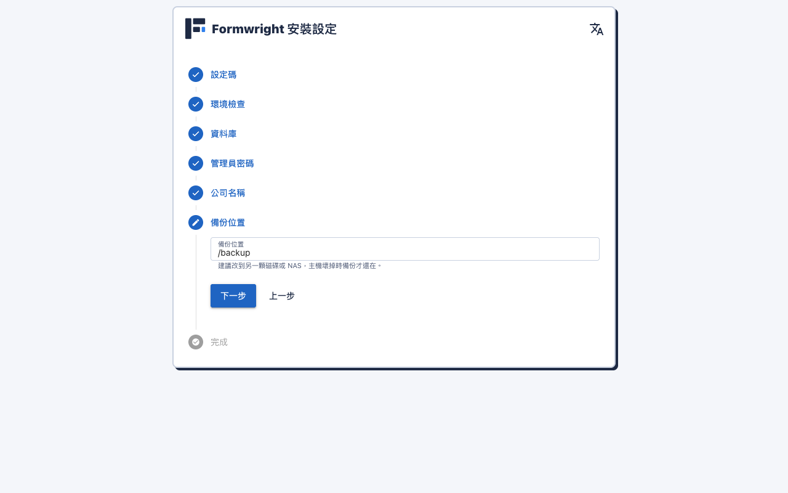

這裡是系統每天自動備份存放的地方。預設是 `C:\ProgramData\Formwright\backup`，也就是跟資料放在同一台電腦。

建議改到**另一顆磁碟**（例如外接硬碟 `D:\FormwrightBackup`）或**公司的網路硬碟（NAS）**。原因很現實：電腦硬碟壞掉時，放在同一顆硬碟裡的備份會一起不見。

- 備份位置不能跟資料、金鑰、程式所在的資料夾重疊，否則會被擋下來。
- 路徑要寫完整（例如 `D:\FormwrightBackup`，不能只寫 `FormwrightBackup`）。
- 資料夾要讓服務有權限寫入（錯誤時畫面會寫「這個位置無法寫入，請確認路徑存在且服務帳號有寫入權限。」）。換到網路硬碟時，要確認這台電腦開機後連得到它。

沒有現成的另一顆磁碟或網路硬碟時，可以先按**下一步**用預設位置，但請盡快安排，不要長期把備份放在同一顆硬碟。

### 第 7 步：完成

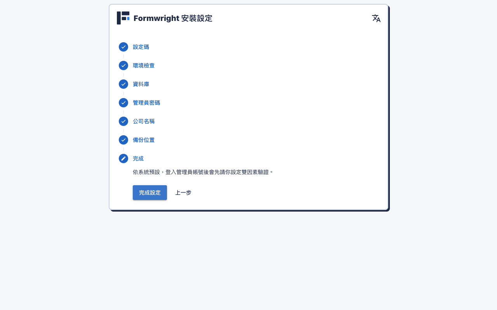

畫面提醒：「依系統預設，登入管理員帳號後會先請你設定雙因素驗證。」按**完成設定**。

站台會自動重新啟動，畫面等到服務回來後會自動跳到登入頁，通常不到一分鐘。如果超過兩分鐘畫面沒動，會出現提示，按**重新整理**。

**精靈只能跑一次**。完成後再開設定頁，只會回到登入頁。

## 6. 第一次登入與雙因素驗證

### 登入

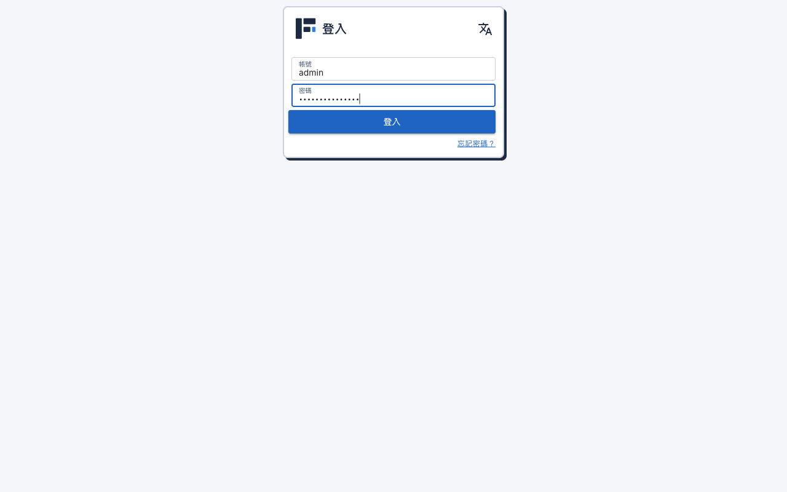

1. 帳號輸入 `admin`。
2. 密碼輸入第 4 步設定的密碼。
3. 按**登入**。

因為密碼是你在精靈裡剛設的，這次不會再要求改密碼。

### 設定雙因素驗證（必做）

雙因素驗證是登入時除了密碼，還要輸入手機 App 上每 30 秒變一次的 6 位數字，別人拿到密碼也進不來。管理員一定要設定，沒設完不能使用其他功能。

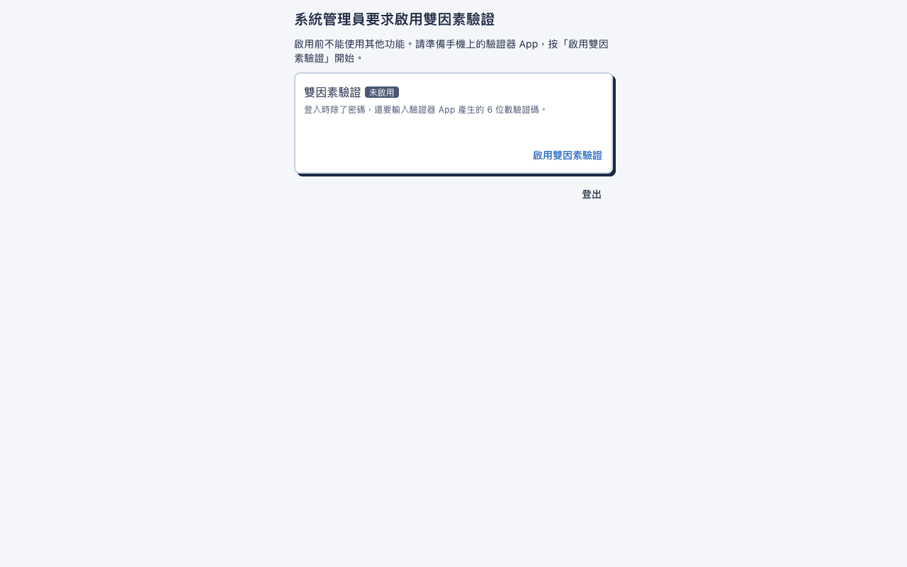

1. 登入後會看到「系統管理員要求啟用雙因素驗證」，按**啟用雙因素驗證**。
2. 彈出視窗要你輸入「目前密碼」，輸入剛才的密碼，按**下一步**。

   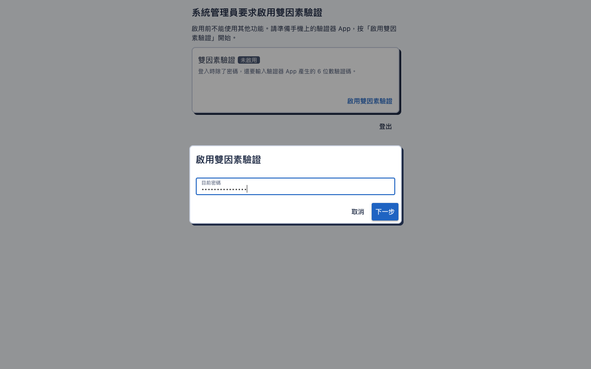

3. 出現「綁定驗證器」，有一個方形的 QR 碼。拿出手機，打開驗證器 App，選「新增」或「掃描 QR 碼」，對準電腦畫面掃描。
   - 掃不了的話（例如手機在遠端），App 裡選「手動輸入」，輸入 QR 碼下方那串「金鑰」。
   - 下面截圖裡的 QR 碼與金鑰刻意模糊，你的畫面是清楚的。

   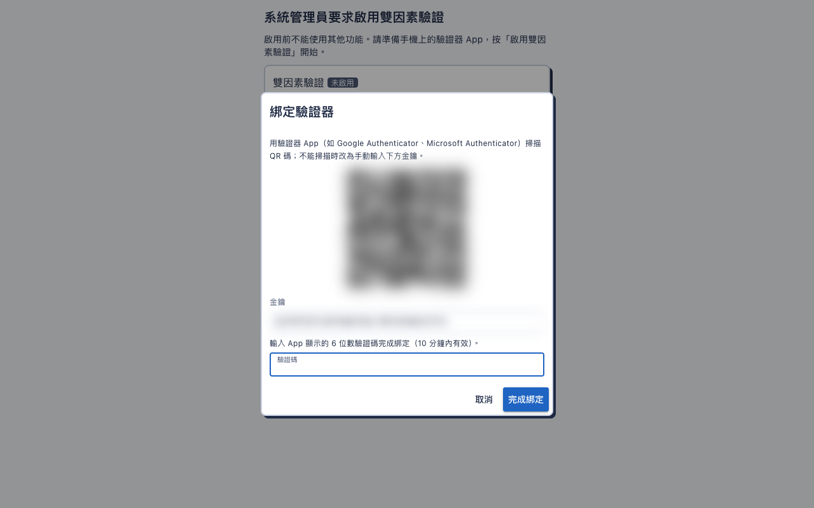

4. 手機 App 會多出一筆 Formwright，上面有 6 位數字。把它輸入「驗證碼」欄，按**完成綁定**。要在 10 分鐘內完成，錯太多次會暫時不能試，過一陣子再來。
5. 出現「復原碼」，共 10 組。**這一步最重要**：

   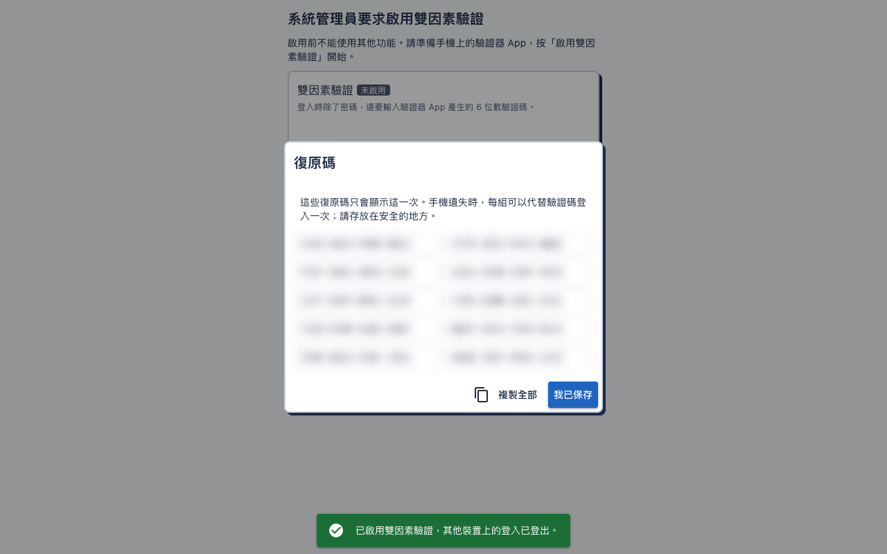

   - 這些復原碼**只會顯示這一次**，關掉就看不到了。
   - 手機弄丟、壞掉、換機而驗證器 App 不見時，每一組復原碼可以代替 6 位數字登入一次。
   - 按**複製全部**後貼到記事本，**印出來或抄下來，放在安全的地方**（例如保險箱）。不要只存在這台電腦上。
   - 存好之後按**我已保存**。

完成後就會進到首頁。以後登入就是：帳號與密碼 → 再輸入手機 App 上的 6 位數字。

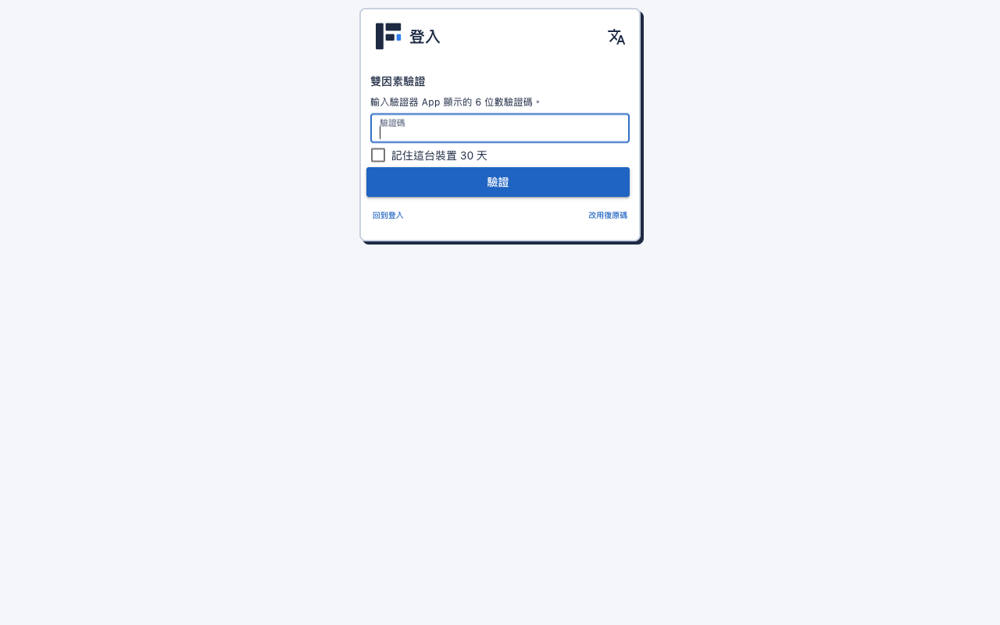

登入時勾「記住這台裝置 30 天」，同一台電腦、同一個瀏覽器 30 天內就不用再輸入數字。手機不在身邊時按「改用復原碼」。

進首頁後，可以開始在「動態模組設計」建立你的第一個模組，或到「應用程式」安裝現成的應用程式；使用方法見[操作手冊](manual.md)。

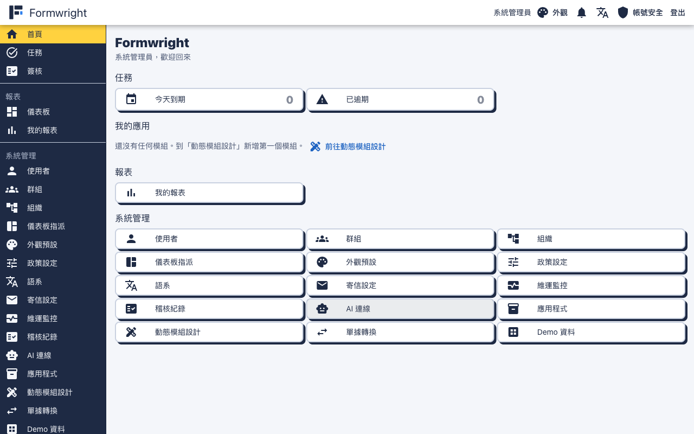

## 7. 讓同事的電腦連進來

同事不需要安裝任何東西，只要在瀏覽器輸入這台電腦的網址。

**第一步：查這台電腦的 IP 位址**（在安裝 Formwright 的那台電腦上）

方法一，用指令：

1. 按鍵盤的 **Windows 鍵**，輸入 `cmd`，按 **Enter**，會開一個黑色視窗。
2. 輸入 `ipconfig` 按 **Enter**。
3. 找到「IPv4 位址」那一行，後面的數字就是 IP，例如 `192.0.2.20`。如果有好幾組，通常是用於上網的那張網卡（「乙太網路卡」或「Wi-Fi」）底下的那一個。

方法二，用設定：Windows 11 的「設定 → 網路與網際網路」，點目前連線（乙太網路或 Wi-Fi）→ 「內容」，捲到最下面找「IPv4 位址」。

**第二步：請同事開網址**

在同事電腦的瀏覽器網址列輸入 `http://` 加上 IP 加上冒號與連接埠，例如：

```
http://192.0.2.20:8080/
```

（連接埠是安裝時的 `8080`；有改過就用改過的。）

**注意**：

- 安裝程式只幫你在 Windows 防火牆放行「同一個網段」的電腦（通常就是同一個辦公室、同一台分享器底下的電腦）。別的網段、外面網路的電腦連不進來，這是刻意的安全設計；要放寬請看[部署指南的防火牆說明](deploy.md#三條安裝路)。
- 這台電腦的 IP 如果每次開機都會變，同事的網址就會失效。可以請公司網管替它保留固定 IP，或在路由器上設定固定位址。
- Formwright 只給公司內網使用。要從外面連進來，請另找 VPN，不要直接把這台電腦開放到網路上。

## 8. 日常：你不用做什麼

- **開機自動啟動**：Formwright 是 Windows 服務，電腦開機後會自己跑起來，不用登入 Windows、不用手動開任何東西。
- **自動備份**：預設每天凌晨 2 點備份一次，自動備份保留最近 7 份（在系統裡按「立即備份」做的備份，預設保留 7 天）。備份內容是資料庫與附件，放在你在精靈第 6 步設定的位置，每一份在其下 `sets` 資料夾裡的一個資料夾。管理員也可以在系統裡按「立即備份」。細節見[部署指南的產品內備份](deploy.md#產品內備份)。
- 請偶爾（例如每月）看一下備份位置，確認有新的備份在長。
- **搬備份要整個備份根目錄一起帶**：資料庫與清單在 `sets` 資料夾裡，附件實體放在同一個備份根目錄下的 `attachments` 資料夾，被所有備份共用。只帶 `sets` 裡的某一份，還原時會缺附件。

## 常見問題

**網頁打不開（在安裝的那台電腦）**

- 確認網址：`http://localhost:8080/`，注意是 `http` 不是 `https`，連接埠要跟安裝時一樣。
- 剛開機或剛裝完，等 1 分鐘再試。
- 按 **Windows 鍵**，輸入「服務」，打開「服務」，找名稱 `Formwright` 那一列，確認狀態是「執行中」。沒有執行就在它上面按右鍵選**啟動**。

**設定碼沒抄到或忘了**

只要還沒跑完設定精靈，設定碼就一直存在電腦裡，重新啟動也不會變。照這樣找回來：

1. 按 **Windows 鍵**，輸入「記事本」，在「記事本」上按右鍵選**以系統管理員身分執行**。
2. 記事本的「檔案 → 開啟」，在檔名欄輸入 `C:\ProgramData\Formwright\data\setup-code`，按**開啟**。
3. 裡面那 12 個字母數字就是設定碼。

精靈跑完之後這個檔案會自動刪除，設定碼也就不再需要。（在這之前，重新執行安裝程式不會再顯示設定碼，因為那是升級流程，請用上面的方法找。）

**精靈環境檢查出現「這個位置已經有 Formwright 的資料」**

表示這台電腦以前裝過 Formwright 並且保留了資料（解除安裝時選了保留），但設定檔不見了，精靈為了不蓋掉資料而停下來。請不要硬刪資料。請找回原本的設定檔，放回畫面上列出的路徑（`C:\ProgramData\Formwright\formwright.json`）後重新啟動服務；找不到就找支援人員協助，見[設定檔遺失](deploy.md#設定檔遺失)。

**同事連不上**

依序檢查：

1. 同事的電腦和這台電腦是不是在同一個網路（同一個辦公室、同一台分享器）？
2. 網址的 IP 是不是還是這台電腦現在的 IP（重新查一次，見第 7 節）？
3. 網址有沒有加連接埠，例如 `:8080`？
4. 這台電腦有沒有開機、Formwright 服務有沒有執行（見上面「網頁打不開」）？
5. 以上都對、同事還是進不去，通常是防火牆只放行同網段，而同事的電腦在不同網段。請找網管處理（部署指南有改範圍的方法）。

**安裝程式失敗、出現「安裝沒有完成」**

訊息會寫出哪一個步驟失敗。Formwright 服務會被停用，避免它一直重啟。排除問題後，再執行一次安裝程式就可以（它會重新啟用服務）。看不懂訊息時，把畫面拍下來找支援人員，細節見[部署指南](deploy.md#三條安裝路)的「Windows 安裝失敗時」。

**怎麼升級到新版**

1. 到 [Releases 頁](https://github.com/KerryHuang/formwright/releases)下載新版的安裝檔。
2. 同第 2 節，用系統管理員身分執行（SmartScreen 也會再擋一次，一樣按「其他資訊」→「仍要執行」）。
3. 它會自動偵測到已安裝，**不會再問連接埠，也不會產生新的設定碼**。它會先停止服務、用舊版做一次備份，備份成功才換成新版；備份失敗就中止，舊版維持不變。你的資料與設定都不會動。
4. 如果備份位置沒設定，它會問「要略過備份繼續升級嗎？」，建議選**否**，先設好備份位置。

**怎麼解除安裝**

1. 按 Windows 的**設定** → **應用程式**，找到 **Formwright**，按**解除安裝**。
2. 會問「要同時永久刪除所有資料（資料庫、附件、金鑰、備份、設定檔）嗎？」。
   - 選**否**（預設）：只移除程式，資料保留，之後重新安裝可以接回。
   - 選**是**：刪掉資料、設定，以及放在預設位置（`C:\ProgramData\Formwright\backup`）的備份，**無法復原**。如果你在精靈第 6 步把備份改到別的磁碟或網路硬碟，那裡的備份**不會**被刪，要另外自己處理。除非確定不再需要，否則請選否。

**怎麼改連接埠**

改連接埠屬於進階設定，見[部署指南](deploy.md#改連接埠)。

**電腦壞了、資料不見了，怎麼辦**

只要備份還在，資料可以還原。請找維護的人員照[部署指南的還原步驟](deploy.md#安裝版的還原)處理；換電腦或硬碟壞掉時照[換主機或資料遺失](deploy.md#換主機或資料遺失)，先在新電腦重新安裝再放回備份。這也是第 6 步要把備份放在另一顆磁碟或網路硬碟的原因；備份只在這台電腦上時，請照同一節定期複製到別處。

## 接著看

- 進階的設定（改連接埠、防火牆範圍、環境變數、PostgreSQL）：[部署指南](deploy.md#安裝版windowsubuntudocker-compose)
- 設定精靈每一步的完整說明：[操作手冊](manual.md#安裝版的設定精靈)
- 雙因素驗證的完整說明：[操作手冊](manual.md#雙因素驗證)
